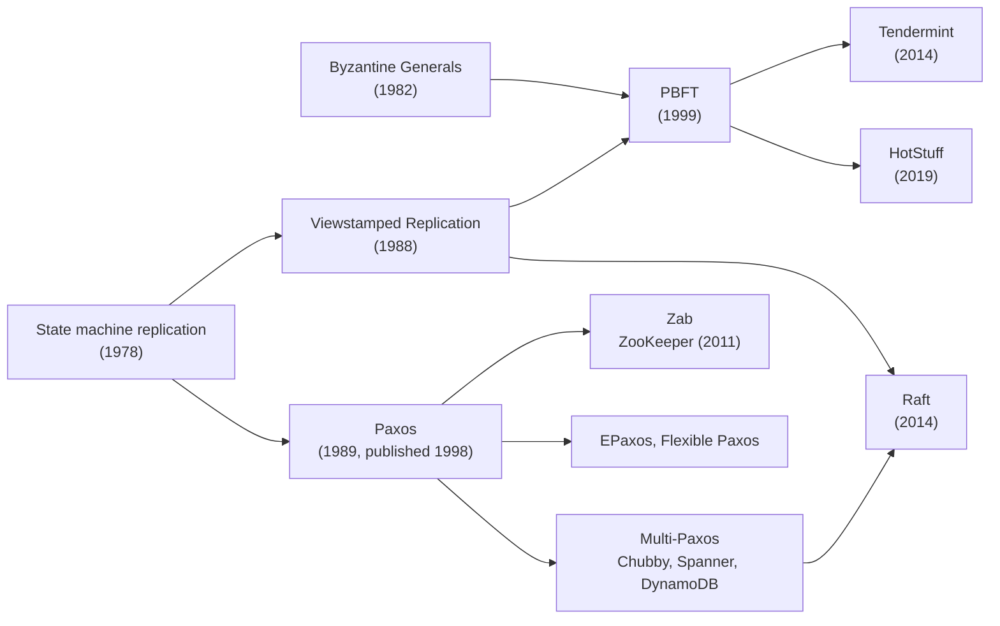

# How consensus evolved: Paxos, PBFT, Raft

> For forty years, people have asked one question: **how do several machines agree on one thing when some of them may fail?** Each protocol on this page is an answer to a version of that question that the previous answer left open.

You don't need to know any of these algorithms to read this page. The goal is the shape of the story: which problem each protocol solved, what it left unsolved, and where you will find it running today. When you want to see *why* any of this is needed, built up from a single bank transfer, read [Why consensus?](02-why-consensus.md).

## The story at a glance

| Year | What happened | The question it answered |
|------|---------------|--------------------------|
| 1978 | Lamport describes replicating a service as "run the same commands in the same order" | What does it mean to replicate something? |
| 1982 | The Byzantine Generals problem | What if some machines lie? |
| 1985 | The FLP impossibility result | Can agreement *always* finish? (No.) |
| 1988 | Partial synchrony; Viewstamped Replication | What can we promise instead? |
| 1989–98 | **Paxos** is written, ignored, then published | How do we agree safely when machines crash? |
| 1999 | **PBFT** | How do we agree when machines can lie, fast enough to use? |
| 2006–11 | Chubby, *Paxos Made Live*, ZooKeeper | What does it take to run this in production? |
| 2014 | **Raft** | Can consensus be easy to understand and build? |
| 2014–19 | Tendermint, HotStuff | Can Byzantine agreement scale to blockchains? |

Read each chapter below the same way: **the question of its time, the idea, where it went, and what it left open.**

---

## Before the algorithms: naming the problem (1978–1988)

Four results from this decade set the rules every later protocol plays by. You don't need the proofs, only what each one means.

**1978: Replication is agreement on order.** Leslie Lamport observed that if every machine starts in the same state and applies the same commands in the same order, every machine ends in the same state, as long as the commands are deterministic. This turns "keep copies of a service in sync" into a narrower question: "agree on the next command in the log." This idea later became known as **state machine replication**, and every protocol on this page is a way of doing it.

**1982: Some failures are lies.** Lamport, Robert Shostak and Marshall Pease framed the *Byzantine Generals* problem: generals must agree on a battle plan by messenger, but some generals are traitors who send different messages to different people. They proved that with plain messages you need more than two-thirds of the generals to be loyal. It was a sobering result, and their solutions assumed messages arrive within known time limits, so it stayed mostly theory for years.

**1985: Agreement can't be guaranteed to finish.** Michael Fischer, Nancy Lynch and Michael Paterson proved that in a fully asynchronous network, where a message can take any amount of time, **no deterministic algorithm can guarantee that agreement always completes if even one machine may crash.** This is the FLP result. The intuition is the one we hit in the bank story: a machine that is slow looks exactly like one that is dead, so you can never be sure whether to keep waiting.

**1988: The way out.** Cynthia Dwork, Nancy Lynch and Larry Stockmeyer showed what you *can* do. Assume the network is "partially synchronous": it may misbehave for a while, but eventually behaves well. Then you can build algorithms that are **always safe**, never giving two different answers, and that **make progress once the network calms down.**

!!! tip "The deal every protocol makes"
    Every algorithm on this page accepts the same trade-off FLP forces on it: **safety always, liveness when the network cooperates.** When the network is bad, a correct consensus system stops making progress. It never makes a wrong decision.

---

## Paxos: the safe core (1989–2001)

### The question

Machines crash and restart, and messages get lost, delayed or duplicated, but nobody lies. Can a group still agree on a value, and never contradict itself, no matter how badly timed the failures are?

### The story

In the late 1980s, colleagues of Lamport at Digital Equipment Corporation's research lab were building a fault-tolerant file system called Echo. Lamport set out to show that what they wanted was impossible, and ended up with an algorithm instead.

He wrote it up as an archaeological report about the parliament of an imaginary Greek island called Paxos, whose part-time legislators kept wandering in and out of the chamber, yet still kept consistent ledgers of the laws they passed. He submitted it in 1990. Reviewers found the allegory baffling, and the paper sat unpublished for eight years. *The Part-Time Parliament* finally appeared in 1998, and in 2001 Lamport rewrote it without the story as *Paxos Made Simple*.

### The idea in plain words

Paxos agrees on **one value**. Any node may *propose* a value, and a group of *acceptors* votes. A proposal goes through two phases:

1. **Prepare.** The proposer picks a ballot number higher than any it has used and asks a majority of acceptors: *"Promise to ignore anything with a lower ballot, and tell me if you have already accepted a value."*
2. **Accept.** If a majority promises, the proposer asks them to accept a value. There is one strict rule: **if any acceptor reported an earlier accepted value, the proposer must propose that value, not its own.**

A value is *chosen* once a majority has accepted it.

Two ideas carry all the safety:

- **Majorities overlap.** Any two majorities share at least one acceptor. So any later proposer's phase 1 will reach at least one acceptor that knows about a value that might already be chosen.
- **Phase 1 is about taking over safely.** It fences out older proposers through the ballot number and discovers what may already have been decided, so the new proposer finishes the job instead of overwriting it.

Real systems need a sequence of values, a log, not one. **Multi-Paxos** runs one Paxos instance per log slot and keeps a stable leader, which runs phase 1 once and then needs only phase 2, a single round trip, for each new entry.

### What it got right

Safety never depends on timing. Several proposers can collide, messages can arrive in any order, and nodes can crash at the worst possible moment, and Paxos will still never choose two different values. Collisions only slow it down: two proposers can keep outbidding each other with higher ballots. That's a liveness problem, and it's solved in practice by having a single leader.

### What it left open

The paper described how to agree on *one value*. Everything a production system needs, such as the log, how to pick and replace the leader, adding or removing machines, snapshots, and how clients retry, was left to implementers. Each team filled those gaps differently, which is the problem Raft later set out to fix.

### Where you find it

Researchers at DEC used Paxos in the Petal storage system and Frangipani file system. Google built its Chubby lock service, Megastore and Spanner on it. Amazon DynamoDB runs Multi-Paxos inside every partition, and Apache Cassandra uses Paxos for its lightweight transactions.

!!! info "The protocol that got there first: Viewstamped Replication"
    In 1988, a year before Paxos was first written up, Brian Oki and Barbara Liskov at MIT published **Viewstamped Replication (VR)**. It was described as a primary-backup system: a primary runs requests and backups follow it, and time is divided into numbered *views*, each with one primary. When a primary fails, a view change picks a new one. At its core is essentially the same agreement idea as Paxos, discovered independently. Paxos became the famous name, but VR is the closest ancestor of Raft, and Liskov's later work on Byzantine faults, PBFT, grew directly out of it.

---

## PBFT: when machines can lie (1999)

### The question

Paxos assumes a faulty machine stops or stalls. But machines can also misbehave: a bug sends wrong data, corrupted memory flips a value, an attacker takes over a node. A machine that sends *different* answers to different peers is called **Byzantine**. Solutions to the Byzantine Generals problem existed, but they either assumed messages arrive within known time limits, which an attacker can easily break, or were far too slow to use.

### The story

In 1999, Miguel Castro and Barbara Liskov published **Practical Byzantine Fault Tolerance (PBFT)**. "Practical" was the point. It was the first Byzantine protocol that stays safe in an asynchronous network like the internet and is fast enough for real work. They built a Byzantine-tolerant version of the NFS file system with it and measured it at only about 3% slower than standard, unreplicated NFS.

### Why it needs 3f + 1 machines

Crash-tolerant protocols need `2f + 1` machines to survive `f` failures. PBFT needs `3f + 1`. Here's the intuition:

- With `n` machines and up to `f` faulty, you can only safely wait for `n − f` replies. The missing `f` might just be slow honest machines.
- Among the replies you *did* get, up to `f` may come from liars.
- For the honest replies to outnumber the liars, you need `n − f − f > f`, which gives **`n > 3f`**.

So tolerating one liar takes 4 machines, and tolerating two takes 7.

### The idea in plain words

PBFT follows the same pattern as VR. A **primary**, the leader of the current numbered view, assigns each request a sequence number. The replicas then go through three rounds of messages, *pre-prepare*, *prepare* and *commit*, and wait for `2f + 1` matching messages at each step. Any two groups of `2f + 1` out of `3f + 1` overlap in at least `f + 1` machines, so the overlap always includes at least one honest machine, the same majority-overlap trick as Paxos, scaled up for liars. If the primary is slow or caught lying, replicas run a **view change** to replace it. Messages are authenticated, so a liar can't pretend to be someone else.

### What it left open

Every replica talks to every other replica, so messages grow with the square of the cluster size, and replacing a faulty primary costs even more. That's fine for 4 or 7 machines, but painful for hundreds. And most companies don't need it at all: machines inside your own datacenter are trusted, so the crash model is cheaper, needing fewer machines and fewer messages.

### Where you find it

PBFT's biggest impact came where trust really *is* split between organizations: blockchains. **Tendermint** (2014, now maintained as CometBFT) adapted PBFT-style voting to proof-of-stake chains such as Cosmos. **HotStuff** (2019) cut the communication so that it grows linearly with the cluster size even when the leader changes, and it became the basis of Facebook's Libra project (LibraBFT, later DiemBFT) and its successors such as Aptos. Bitcoin is a different branch altogether. It works with open, anonymous membership and reaches agreement probabilistically through proof of work, rather than through voting rounds.

---

## Paxos meets production (2006–2011)

### The question

Paxos was proven correct. Could teams actually ship it?

### The story

In 2006, Google described **Chubby**, a lock service where a "cell" of five replicas uses Paxos to agree on its state. Google's file system (GFS) and Bigtable used Chubby to elect their masters. The next year, the Chubby team published ***Paxos Made Live***, a candid account of what it took. A page of pseudocode had turned into several thousand lines of C++. They had to handle disk corruption, master leases, changing group membership, snapshots, and a testing regime built to inject failures. Every gap the paper left open had to be filled with their own design, which they could no longer formally prove correct.

At Yahoo, the team building **ZooKeeper**, an open-source coordination service later used across the Hadoop ecosystem and by Kafka, chose not to use Paxos directly. They designed **Zab**, a primary-backup broadcast protocol organized around numbered *epochs*, that fit how ZooKeeper sends a stream of state changes from one primary.

### What it left open

By the early 2010s, consensus was clearly essential infrastructure, but every serious implementation was a custom extension of a hard-to-read paper. It was difficult to teach, difficult to verify and easy to get subtly wrong.

---

## Raft: designing for understanding (2014)

### The question

Could a consensus algorithm be as safe and efficient as Multi-Paxos, but **easy to understand, and complete enough to build directly from the paper?**

### The story

At Stanford, Diego Ongaro and John Ousterhout made understandability the primary design goal, an unusual choice for an algorithms paper. Their paper, *In Search of an Understandable Consensus Algorithm*, won Best Paper at USENIX ATC 2014. They tested the claim directly. In a study with 43 students at two universities who learned both algorithms, 33 answered questions about Raft better than questions about Paxos.

### The idea in plain words

Raft provides the same guarantees as Multi-Paxos. The difference is in its structure:

- **Decomposition.** The problem is split into three parts you can learn separately: **leader election**, **log replication**, and **safety**.
- **A strong leader.** Log entries flow only from the leader to followers, never the other way.
- **Fewer possible states.** Logs never have holes. Time is divided into numbered **terms**, with at most one leader per term. Elections use randomized timeouts so split votes resolve quickly.
- **The whole system, not just the core.** The paper covers membership changes, log compaction and client interaction, the exact gaps *Paxos Made Live* had to fill in on its own.

If you've read [Why consensus?](02-why-consensus.md), you've already met every core piece: majority commit, terms, the rule that you don't vote for a candidate with a less up-to-date log, and rejecting messages from an older term.

### Where you find it

Raft became the default choice for new systems. etcd adopted it even before the paper was published, and through etcd it runs every Kubernetes cluster. It's also in Consul and Vault, CockroachDB, TiKV and TiDB, ClickHouse Keeper, and Kafka, whose KRaft mode replaced ZooKeeper entirely in Kafka 4.0 (March 2025). MongoDB's replica-set elections use a protocol based on Raft.

### What it left open

Raft didn't make consensus *safer*; it made it *buildable and teachable*. It also keeps the classic costs: all writes go through one leader, and every commit waits for a round trip to a majority. Large systems get around this by running thousands of small Raft groups side by side, as described in [Consensus in real systems](03-real-world-systems.md).

---

## Where it went next

The family keeps growing along two branches.

**Crash-tolerant (trusted machines).** *EPaxos* (2013) removes the single leader, so any replica can commit commands that don't conflict. *Flexible Paxos* (2016) showed that the quorum used to elect a leader and the quorum used to replicate entries only need to overlap with *each other*, not every majority with every other, which lets you tune for faster writes or faster recovery. In production, the dominant trend is many small Raft or Paxos groups, one per shard.

**Byzantine-tolerant (untrusted machines).** This branch is mostly driven by blockchains: Tendermint and HotStuff, mentioned above, and newer protocols that pipeline rounds and rotate leaders frequently.

*The lines show the most direct influences, not every connection. Most of these protocols borrowed from several ancestors.*

---

## Side by side

| | Fault model | Machines to survive `f` faults | Leader? | Known for | Where you'll meet it |
|---|---|---|---|---|---|
| **Paxos / Multi-Paxos** | Crash | `2f + 1` | Optional in Paxos; stable leader in Multi-Paxos | The first widely known safe core; hard to read | Chubby, Spanner, DynamoDB, Cassandra LWT |
| **Viewstamped Replication** | Crash | `2f + 1` | Yes (primary per view) | Got there first; full system design | Mostly as Raft's ancestor |
| **Zab** | Crash | `2f + 1` | Yes (per epoch) | Ordered stream of state changes from a primary | ZooKeeper |
| **Raft** | Crash | `2f + 1` | Yes (per term) | Designed to be understood and built | etcd, Consul, CockroachDB, TiKV, Kafka |
| **PBFT** | Byzantine | `3f + 1` | Yes (primary per view) | First practical Byzantine protocol | Research systems; ancestor of blockchain BFT |
| **HotStuff** | Byzantine | `3f + 1` | Yes, rotating | Linear communication, even across leader changes | Diem/Aptos family of blockchains |

---

## Three things to remember

1. **Every protocol makes the same deal.** FLP says agreement can't be guaranteed to finish, so every protocol is always safe and only makes progress when the network cooperates.
2. **The big fork is crash versus lies.** If your machines are trusted, use a crash-tolerant protocol: `2f + 1` machines and majorities. If they aren't, you need Byzantine tolerance: `3f + 1` machines and two-thirds quorums, at a much higher cost.
3. **Raft's contribution was understanding, not safety.** It made the ideas Paxos and VR proved buildable and teachable. That's why it's the one you'll meet most often.

---

## Read the originals

In a sensible order, from gentlest to deepest:

1. [In Search of an Understandable Consensus Algorithm](https://raft.github.io/raft.pdf), Ongaro and Ousterhout, 2014. Start here.
2. [Paxos Made Simple](https://lamport.azurewebsites.net/pubs/paxos-simple.pdf), Lamport, 2001. Short, and much easier after Raft.
3. *Paxos Made Live: An Engineering Perspective*, Chandra, Griesemer and Redstone, 2007. What production adds.
4. [Practical Byzantine Fault Tolerance](https://pmg.csail.mit.edu/papers/osdi99.pdf), Castro and Liskov, 1999.
5. *Viewstamped Replication Revisited*, Liskov and Cowling, 2012. VR, rewritten clearly.
6. *The Part-Time Parliament*, Lamport, 1998. The original, for the history.
