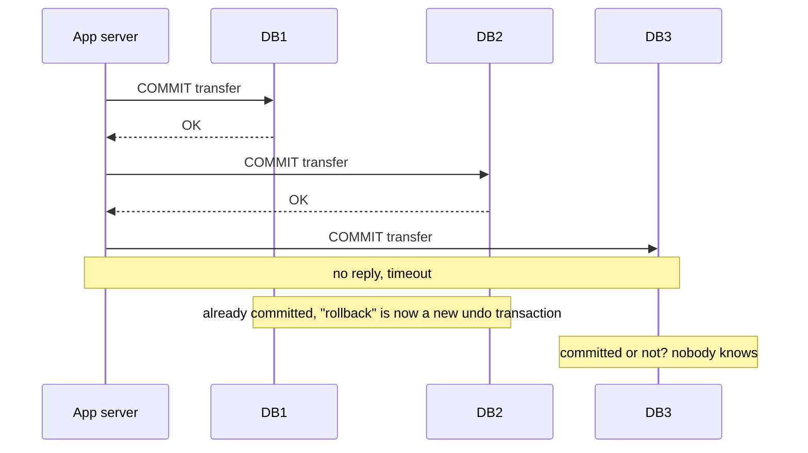
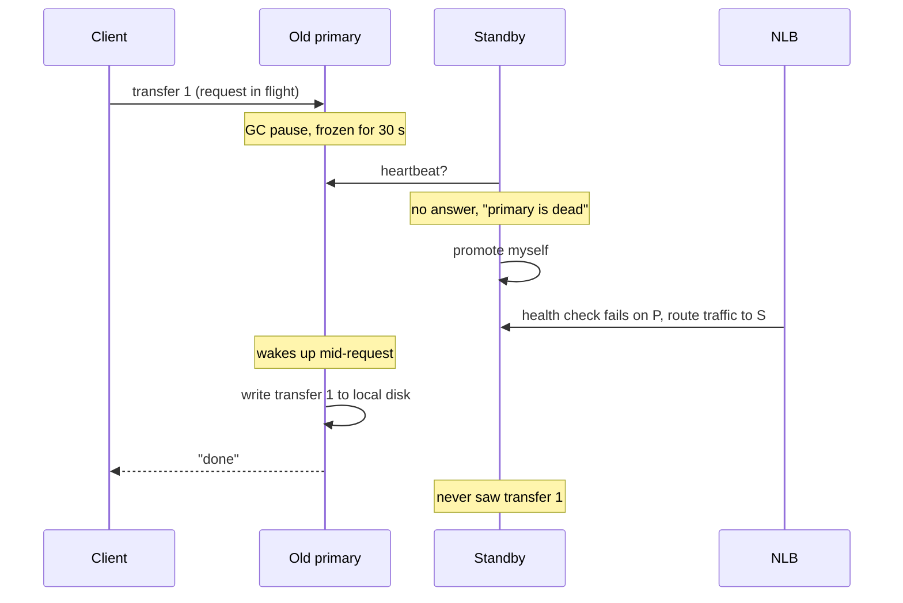
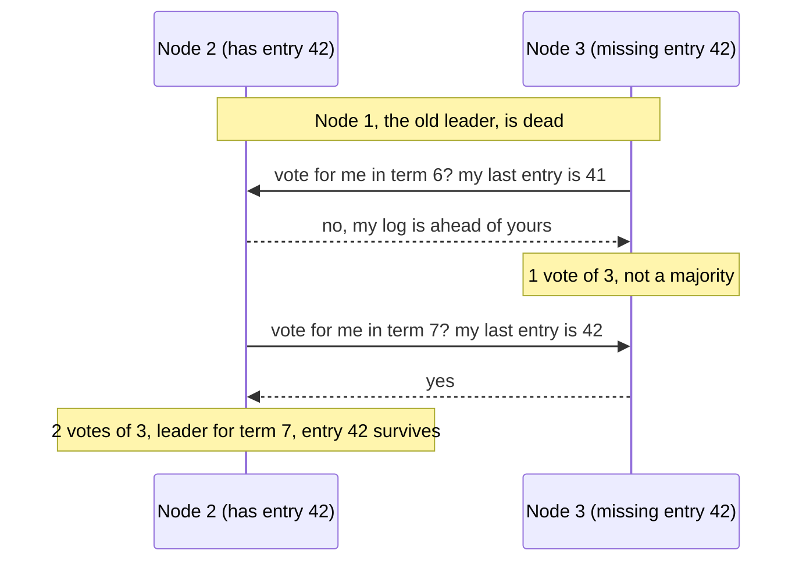
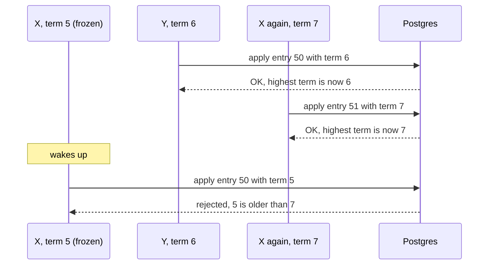

# Why consensus? A story

---

## The setup

User A sends ₹100 to user B. Our bank keeps balances in Postgres.

A single Postgres machine is a single point of failure. If it crashes, nobody can send money. If its disk dies, money is lost. So we want **several copies of the same data on different machines**.

Two words that are easy to mix up:

- **Sharding** splits the data. Users A–M live on one machine, N–Z on another. That helps when the data or traffic is too big for one machine, but it doesn't protect against a machine dying. If shard 7 dies, everyone on shard 7 is stuck.
- **Replication** keeps copies of the *same* data. That is what protects you when a machine dies.

Real systems do both: shard for size, then replicate every shard. This page is about replication: how several copies of the same data stay in agreement.

**The goal:** a transfer we confirmed is never lost and never applied twice, even when machines crash, freeze, or the network misbehaves.

---

## Attempt 1: Write to every copy, roll back if any fails

### The idea

Run three Postgres instances: DB1, DB2 and DB3. When a transfer arrives, the app server commits it to all three. If all three say OK, tell the user "done". If any one fails, roll back on the others.

It looks like it needs no protocol at all, just a simple rule. If one database is badly broken, a circuit breaker stops us from waiting on it forever.

The app server sends the commit to DB1. OK. To DB2. OK. To DB3... silence. After a few seconds it times out. Following the rule, the app server rolls back the transfer on DB1 and DB2.



### Where it breaks

- **There is nothing left to roll back.** DB1 and DB2 have already *committed*. In Postgres a committed transaction can't be rolled back. You can only run a *new* transaction that undoes it. Between the commit and the undo, other requests can already see the money as moved, and the undo itself can fail.
- **A timeout doesn't tell you what happened.** DB3 might never have received the request. It might have crashed before committing, or committed and crashed before replying. Its reply might have been lost on the way back, or it might just be slow and about to commit. From the app server, all of these look the same. If DB3 did commit, then after our "rollback", DB1 and DB2 say the transfer never happened while DB3 says it did. The copies now disagree, which is exactly what we were trying to avoid.
- **The app server can crash halfway.** If it dies after DB1 commits but before it reaches DB2, nobody is left who knows the transfer was half done.
- **One machine down stops everything.** "All must succeed" means we can only accept writes while *every* copy is up. Three machines are now *less* available than one. If the circuit breaker lets us skip the dead DB3, then DB3 falls behind. When it returns, someone has to work out what it missed and which copy is right.

### What we learned

- Requiring **every** copy is too strict. It costs availability and still doesn't keep the copies in agreement.
- Once something is committed, "undo" is not simple.
- A timeout means **"I don't know"**, not "it failed".

This idea is close to **two-phase commit (2PC)**. Real 2PC adds a "prepare" step, so every participant promises it can commit before anyone does, and that fixes the half-committed problem. But it still needs every participant to be up, and it gets stuck if the coordinator dies at the wrong moment. 2PC is the right tool for a different job; see the [side note](#side-note-isnt-this-just-2pc) at the end.

---

## Attempt 2: One primary, one standby, and a kill switch

### The idea

Stop writing to many places at once. This is how plain Postgres is usually run: one **primary** takes all the writes and streams its changes to a **standby**. With only one writer, the copies can't disagree about order. If the primary dies, promote the standby.

To make sure the old primary doesn't keep working after the switch, add a kill switch. Any of these would do:

- the new primary sends the old one a "stop" message;
- the old primary regularly checks a flag in a file system;
- we update the load balancer (NLB) so clients can no longer reach the old primary.


It's 2 a.m. The primary is in the middle of handling transfer #1 when it freezes. A long garbage-collection pause holds it for 30 seconds. To everyone else it looks dead.

The standby misses its heartbeats, decides the primary is gone and promotes itself. The NLB's health checks fail, and it moves traffic to the new primary. So far, so good.

Then the old primary wakes up. From its point of view, no time has passed. It is still the primary, halfway through transfer #1. It writes the transfer to its own disk and replies "done" to the client. The new primary has never heard of this transfer.



### Where it breaks

- **Nobody can tell "dead" from "slow".** A missing heartbeat looks the same whether the primary crashed, froze, or only the link between primary and standby broke. In that last case the primary is still serving clients happily while the standby promotes itself. Now there are two primaries. This is called **split brain**.
- **Every kill switch is in a race with the frozen node.**
  - *A "stop" message from the new primary.* It took over *because* it couldn't reach the old primary, so its stop message has the same problem. And if the message does get through, the old primary wasn't dead after all.
  - *The old primary checks a flag.* Between two checks it keeps accepting writes. Also, the file system holding the flag has to be replicated and kept in agreement, which is our original problem again.
  - *The NLB.* Health checks run every few seconds and need several failures in a row before a node is marked down. Requests that were already inside the old primary got past the NLB before anything changed. And an NLB's normal job is to spread traffic over *all* healthy targets, so when the old primary wakes up and passes a health check, it starts getting traffic again. An NLB promises to *eventually* stop sending traffic to a bad target. It never promises to *never* send traffic to two.
- **A frozen node can't know it was replaced.** When it wakes up, it doesn't check a flag first. It just finishes the work it was in the middle of. No outside switch can reach inside a paused process.
- **The standby may not have everything.** With asynchronous replication, the last few transfers the primary confirmed may never have reached the standby, and promoting it loses them. With synchronous replication to the single standby, the primary can't confirm anything while the standby is down. With only two machines, you can't have both "never lose a confirmed write" and "keep working when one machine dies".

### What we learned

- A node **cannot know, by itself, that it has been replaced**.
- Trying to stop requests from *reaching* an old leader always leaves a window open.
- Something has to *decide* who the leader is, and that decider has to survive failures too.

---

## Attempt 3: Push the problem into a durable shared log

### The idea

Make the app servers stateless. Every transfer is first appended to a **write-ahead log (WAL)** stored on a distributed file system that "guarantees durability and availability". Once a transfer is in the log, it's safe, and Postgres just applies whatever is in the log. That gives a clear commit point: **committed means written to the log**.

To pick who is in charge, use the same storage.

### The story

Two stateless app servers receive two transfers at the same moment. Server X gets "A sends ₹100 to B". Server Y gets "A sends ₹100 to C". A has only ₹100. Both append to the shared log.

### Where it breaks

The distributed file system isn't magic. Inside, it is a few machines with disks, and they face every question we were trying to escape:

- **When is an append "written"?** When one of its machines has it, or when all of them do? "All" is Attempt 1 again. "One" is a single point of failure.
- **In what order?** X and Y append at the same instant. Every machine in the file system has to agree which one came first. Otherwise they apply the transfers in different orders and end up with different balances.
- **What if one of its machines can't be reached?** Does it keep accepting appends or stop? If it keeps going, how does the missing machine catch up and find out what it missed?

And "use the storage to pick the leader" doesn't help, because the storage needs a leader of its own to keep appends in order.

We didn't solve the problem. We moved it into another box. You can push it down as many layers as you like, but at the bottom, some group of machines has to agree by itself, without leaning on anything else.

### What we learned

- "Use a reliable distributed X" just relocates the agreement problem.
- Separating stateless compute from a durable log is a good idea, and real systems do it. But the log has to be built on something that can agree when machines fail.

---

## The turning point

We now know exactly what is missing: **a small group of machines that can agree on one ordered log, keep working when some of them fail, and never lose an entry they confirmed.** The rest of this page builds that group one rule at a time, each rule fixing one of the breaks above.

---

## Rule 1: A write counts once a majority has it

### The story

Three machines hold the log. Waiting for all three fails as soon as one is down (Attempt 1). Trusting just one loses data when that one dies (Attempt 2). So try the middle: an entry is **committed** once 2 of the 3 machines have stored it.

Why 2? Take any two groups of 2 machines out of 3, such as {1, 2} and {2, 3}, or {1, 3} and {1, 2}. They always share at least one machine. **Any two majorities overlap.**

So say transfer #42 was stored on a majority. Later some machines crash and a different majority carries on. At least one machine in that new majority still has #42, so a committed entry can't quietly disappear.

### The rule

- A group of `n` machines needs a majority: `floor(n/2) + 1`.
- To survive `f` crashed machines you need `2f + 1` of them. 3 machines survive 1 failure, and 5 survive 2.
- A 4th machine buys nothing over 3. The majority of 4 is 3, so it still survives only 1 failure.
- The price: if a majority can't be reached, the system stops accepting writes. It chooses being correct over being available, which is what a bank wants.

---

## Rule 2: Elect the leader by majority vote, and number every election

### The story

Someone still has to put entries in order (Attempt 3 showed that two writers can't). So there is one leader. When it dies, the others need a new one, and Attempts 2 and 3 showed that no outside switch can safely choose it. So the machines choose it themselves, by voting:

1. The leader sends regular heartbeats. A follower that hears nothing for a while assumes the leader is gone. "A while" is a timeout picked at random, say between 150 and 300 ms.
2. That follower becomes a **candidate**. It starts a new election, votes for itself, and asks the others for their votes.
3. Each machine votes **at most once per election**. It writes its vote to disk, so a restart can't make it vote twice.
4. A candidate with a majority of the votes wins. Any two majorities overlap and nobody votes twice, so **two candidates can't win the same election**.
5. If the votes split and nobody wins, the random timeouts expire again at different moments, and usually someone gets in first the next time.

Every election gets a number one higher than the one before. That number is the **term**.

### Who should be allowed to win?

Node 1 was the leader. Transfer #42 reached nodes 1 and 2, so it is committed, and the client was told "done". Then node 1 dies for good. Nodes 2 and 3 remain, and node 3 never received #42.

If node 3 became leader, its log would become the truth, and #42, a transfer the customer was told had succeeded, would vanish. So voting gets one more rule: **don't vote for a candidate whose log is behind yours.**

Node 3 asks node 2 for its vote. Node 2 sees that node 3 is missing #42 and says no, so node 3 can't reach a majority. Then node 2 runs, node 3 votes for it, and node 2 wins. #42 survives.



Majority overlap guarantees that in every winning majority, at least one voter has every committed entry. This rule makes sure that voter blocks any candidate that doesn't.

### What voting does *not* guarantee

Remember the frozen primary from Attempt 2. Voting doesn't stop that. The term 5 leader can freeze, the others elect a term 6 leader, and when the old one wakes up it still *believes* it is the leader.

Voting guarantees **at most one leader per term**. It does *not* guarantee that only one machine *thinks* it is the leader at any given moment. Nothing can guarantee that. The remaining rules make it harmless.

---

## Rule 3: The log is the truth, and the database just replays it

### The story

The leader receives a transfer, appends it to its log, and sends it to the followers. Once a majority have stored it, it is committed. Every machine then **applies** committed entries to its database **in log order**. The leader answers the client after applying, so it can report the real result.

Now go back to the double spend from Attempt 3. A has ₹100, and the log contains:

- #42: A sends ₹100 to B
- #43: A sends ₹100 to C

Both entries are committed. Every machine applies #42, leaving A with ₹0. Then it applies #43, sees that A can't pay, and rejects it. Every machine applies the same entries, in the same order, with the same logic, so every machine rejects #43 without talking to the others.

Two consequences follow:

- **Applying has to be deterministic.** If applying an entry used the current time or a random number, machines could reach different results. The leader fills in such values *before* the entry goes into the log.
- **Committed entries are never deleted.** The log records *commands*, not outcomes. #43 stays in the log forever. Its outcome is "rejected", and every machine works that out the same way. Old entries can later be compacted into a snapshot, but they are never rewritten.

An entry that never reached a majority is different. No client was told "done" about it, so a new leader is allowed to overwrite it.

---

## Rule 4: Make applying safe to repeat (the sequence number)

### The story

A machine commits #42 to Postgres, then crashes before recording "I applied #42" anywhere. The next leader sees #42 as not applied and applies it again. A pays twice.

This one bites even with a perfect election. The cause is that we wrote to two different places, Postgres and a separate "applied" flag, and only one of the two writes happened.

The fix is to keep the "applied" record **inside the same Postgres transaction** as the transfer, so either both happen or neither does. And because the log is ordered, we don't need a list of every applied transfer. One number is enough: the last entry applied.

```sql
CREATE TABLE apply_state (
  id           int PRIMARY KEY,   -- always 1
  last_applied bigint NOT NULL
);
```

Applying #42 begins with a **compare-and-set**. Move the number from 41 to 42, but only if it is 41 right now:

```sql
UPDATE apply_state SET last_applied = 42
 WHERE id = 1 AND last_applied = 41;
```

If that updates 0 rows, #42 was already applied, or it isn't the next entry. The whole transaction is **rolled back**, and the caller is told "already applied" rather than "error".

A new leader recovers using the same number. It asks Postgres for `last_applied`, then replays everything after that from the log.

### Why the order of statements matters

Postgres doesn't run whole transactions one after another. But two transactions that update the **same row** are forced into order: the second waits for the first one's row lock. At the default isolation level (READ COMMITTED), once the first commits, Postgres re-checks the second one's `WHERE` against the row's *new* value. At stricter isolation levels it raises a serialization error instead.

Suppose the balance updates come first and the guard comes last. Two machines apply #42 at the same moment. The second one waits on A's row. When the first commits, the second one's `balance - 100` runs against the new balance and succeeds. Only after that does its guard find 0 rows. If it commits anyway, A has paid twice.

So **put the guard first**. Then the second transaction waits on the `apply_state` row, sees 42, matches 0 rows, and rolls back before it touches any balance.

---

## Rule 5: Fence stale leaders at the storage (the term)

### The story

Rules 1 to 4 keep the log and the apply step honest. But in our design, Postgres sits outside the group that votes. A frozen leader that wakes up can still send writes straight to Postgres, and Postgres has no idea an election ever happened.

The first fix that comes to mind is to store the current leader's **name** in the table and refuse writes from anyone else. A stale leader never sends an "I'm the leader now" update, because it thinks nothing changed. That's a good observation, but try this:

> X leads in term 5 and freezes. Y wins term 6 and writes "Y". Y crashes. X is elected again in term 7 and writes "X". Then the process that froze back in term 5 wakes up with its old in-flight write, tagged "X".

The table says "X", and the write says "X", so it gets through. The name can't help, because both writes come from the same machine. The only thing that differs is *which election each one won*, and that is the term.

### The rule

Every write to Postgres carries the writer's term. Postgres keeps the highest term it has seen and:

- **accepts** a write whose term is equal to or higher than the stored one, raising the stored term if needed;
- **rejects** any write with a lower term.

This is called a **fencing token**. Notice how much it handles on its own:

- **The frozen leader:** its term 5 is lower than 7, so it is rejected.
- **Messages arriving out of order:** Y's delayed term 6 write arrives after a term 7 write. 6 is lower than 7, so it is rejected.
- **Telling Postgres about a new leader:** no separate step is needed. The new leader's first write raises the stored term.

The term is only safe because two leaders can never hold the same one. That comes from Rule 2: one vote per machine per term, and a majority to win.



### The full apply transaction

Add the term to the table:

```sql
ALTER TABLE apply_state ADD COLUMN term bigint NOT NULL DEFAULT 0;
```

Then the term 9 leader applies entry #42 like this:

```sql
BEGIN;

-- 1. Guard first: claim entry 42 for a leader of term 9.
UPDATE apply_state
   SET last_applied = 42,
       term         = 9
 WHERE id = 1
   AND last_applied = 41   -- 42 must be the very next entry
   AND term <= 9;          -- refuse leaders from older terms
-- 0 rows updated → ROLLBACK: a duplicate, out of order, or a stale leader.

-- 2. Apply the entry.
UPDATE accounts SET balance = balance - 100
 WHERE id = 'A' AND balance >= 100;
-- 1 row updated → credit B:
UPDATE accounts SET balance = balance + 100 WHERE id = 'B';
-- 0 rows updated → A can't pay. The entry is still applied and its
-- outcome is "rejected", so we skip the credit and still COMMIT the guard.

COMMIT;
```

### The gap that's left

Until the new leader's first write reaches Postgres, the stored term is still the old one, so the old leader's writes still get in. That's harmless as long as the old leader is only applying entries that are already committed in the log, because Rule 4's sequence check keeps it honest. It is only dangerous if the old leader can still put **new** entries into the log. That leads to the last rule.

---

## Rule 6: Fence the log too

> Try this one yourself before reading on: what must the log check on every append?

The same thing Postgres checks. Every append the leader sends to its followers carries the leader's term. A follower that has already seen a higher term refuses the append and replies with that newer term, and the old leader sees it and steps down.

A majority has already moved on to the new term, so a stale leader can never get a new entry onto a majority. That means it can never commit anything. When the new leader takes over, it overwrites any uncommitted entries the old leader left on some of the followers.

So the term guards both doors. The log refuses stale *appends*, and the database refuses stale *applies*.

---

## Who does which job: safety vs liveness

There are two kinds of promise:

- **Safety:** nothing bad ever happens. No committed entry is lost, no two machines disagree about entry #42, and no transfer is applied twice.
- **Liveness:** something good eventually happens. After a crash, transfers keep getting processed.

Our first instinct was to make the election responsible for preventing inconsistencies. That would require the election to be perfect, and Attempt 2 showed that a perfect election is impossible, because a frozen node always wakes up believing it is the leader.

The way out is to split the jobs:

> **The election is responsible for liveness**: someone is always doing the work.
> **Majorities and terms, checked by the log and the storage, are responsible for safety**: a stale or wrong leader's writes are refused.

The election is allowed to be briefly wrong, with two nodes each thinking it leads, and nothing bad happens.

---

## Put together: we rebuilt Raft

| What we built | The break it fixed | What Raft calls it |
|---|---|---|
| Commit once a majority has stored the entry | "All" stalls on one failure; "one" loses data | Majority replication, commit index |
| Machines vote, once each per election | Outside kill switches always race | `RequestVote`, one vote per term |
| A number for every election | A name can't tell old X from new X | Term |
| Don't vote for a candidate whose log is behind | Node 3 would erase #42 | Election restriction (most up-to-date log wins) |
| One ordered log that every machine applies in order | Two writers, two different orders | Replicated log, replicated state machine |
| Applying is deterministic | The same log must give the same balances | Deterministic state machine |
| `last_applied` in the same transaction | Crash between applying and recording it | `lastApplied`, idempotent apply |
| Followers reject appends from older terms | A stale leader adding new entries | Term check on `AppendEntries` |
| Storage rejects writes from older terms | A stale leader writing to Postgres | Fencing token |
| Heartbeats and random timeouts | Noticing that the leader is gone | Heartbeats, randomized election timeout |

Raft has a little more machinery that this story didn't need: each append also says what the previous entry was, so a follower can spot gaps; a new leader only counts replicas for entries from its own term; and there are snapshots and safe membership changes. The [Raft paper](https://raft.github.io/raft.pdf) covers all of them, and [How consensus evolved](01-evolution.md) shows where each idea came from.

---

## Side note: isn't this just 2PC?

They look alike: Paxos, the older relative of Raft, also has two rounds of messages, and its first one is even called "prepare". But they solve different problems.

- **2PC solves atomic commit.** Each participant holds *different* data, for example A's account on shard 1 and B's on shard 2. Every participant must say yes, and any single "no" aborts the transaction. If the coordinator dies after "prepare", the participants are stuck holding locks until it returns.
- **Consensus solves agreement on one ordered history** across copies of the *same* data. A majority is enough, and if the leader dies, any node can safely take over. In Paxos, the first round isn't "can you commit?" but "I'm taking over; tell me anything that may already have been decided."

Jim Gray and Leslie Lamport showed that 2PC is the special case of their "Paxos Commit" that tolerates zero failures.

Real databases stack the two. In Spanner and CockroachDB every shard is a consensus group, and a transaction that touches several shards runs 2PC *between* those groups. Since each participant and the coordinator are themselves replicated, a crash no longer leaves everyone stuck.

---

## Think it through

1. Why does a 4th node buy nothing over 3? What does a 5th node buy?
2. Two nodes both believe they are the leader. Walk through exactly why neither of them can corrupt the log.
3. In Rule 4, what goes wrong if `last_applied` lives in a separate system and is updated in a separate step?
4. A client's transfer request times out. Did the transfer happen? How should the client retry without paying twice? (Rule 4 protects the server side; the client needs its own idempotency key.)
5. A node was down for an hour. What does it need in order to catch up, and who tells it?
6. Why must applying an entry be deterministic? Give an example of an apply step that would make two replicas drift apart.
7. The new leader has won term 9 but hasn't written to Postgres yet. What can the term 7 leader still do during that window, and why is it harmless?

---

## Where next

- [Consensus in real systems](03-real-world-systems.md): where etcd, Kafka, Spanner and CockroachDB use exactly these rules.
- [How consensus evolved](01-evolution.md): how Paxos, PBFT and Raft arrived at these rules over forty years.
- **Leases + fencing tokens** (coming next): Rule 5 in its general form, for any resource a stale owner might still touch.
- The [Raft paper](https://raft.github.io/raft.pdf), sections 5 and 6. After this page, most of it should read like a summary of what you built.
