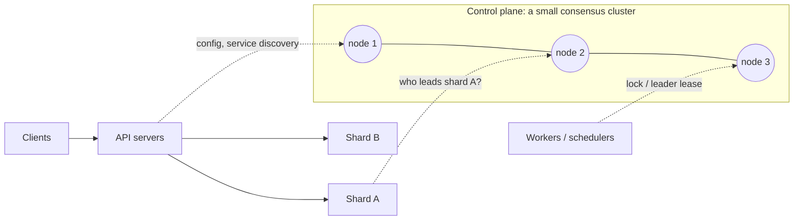
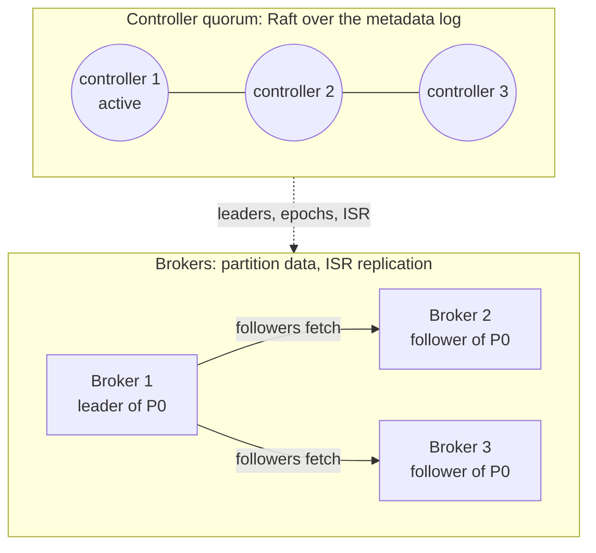
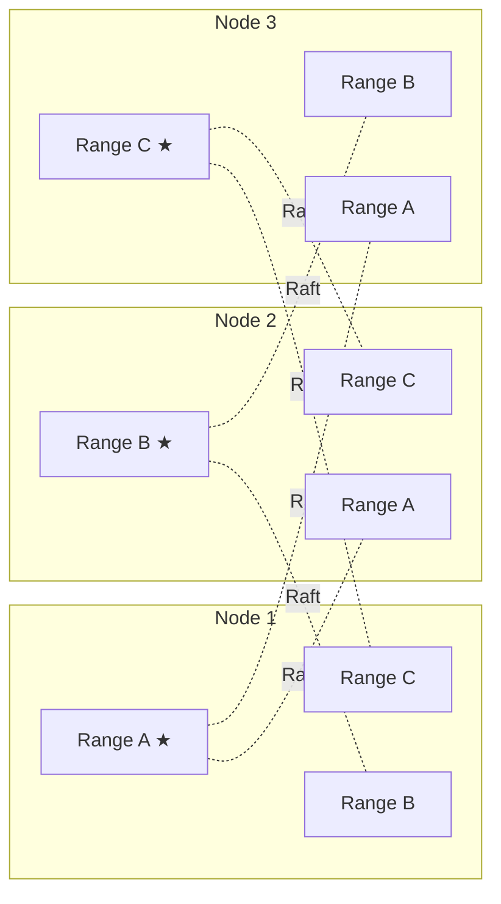

# Consensus in real systems

> Once you know the rules from [Why consensus?](02-why-consensus.md), you start seeing them everywhere: majorities, terms, fencing, a replayed log. What's interesting is not *that* real systems use consensus, but **how little of their data they put through it**, and why.

This page tours the production systems you're most likely to meet. Each one is told the same way: **the situation** it's in, **where consensus fits**, and **the lesson** to carry into your own designs.

---

## The one question behind every design

Every system on this page answers the same question for each piece of data it holds:

> **If two machines disagreed about this for a few seconds, what would break?**

- **Something irreversible:** a job runs twice, money moves twice, two owners write to the same resource, or a confirmed write disappears. That fact needs agreement: consensus, or something built on it, like a lease.
- **Something temporary and harmless:** a like count is off by a few, a feed is a few seconds stale, or a "last seen" time lags. Eventual consistency is fine here, and consensus would cost you latency for nothing.

| Fact | If machines disagree | Needs consensus? |
|------|----------------------|------------------|
| Which replica is the primary for a shard | Two primaries, diverging data | Yes |
| Which worker owns a job | The job runs twice | Yes, usually as a lease |
| The next free range of IDs | Duplicate IDs | Yes, once per range |
| Number of likes on a post | A count off by a few, briefly | No |
| A user's "last active" time | A slightly stale value | No |

Consensus costs a round trip to a majority plus a disk flush on every decision. That's about a millisecond inside one datacenter, and 100 ms or more across continents. All writes in a group also go through one leader, and a node cut off from the majority must stop accepting writes. So production systems keep consensus **as small as they can get away with**. They do that in one of three ways:

| Shape | The idea | Examples |
|-------|----------|----------|
| **A small brain for a big body** | A separate, small cluster holds the few facts everything else depends on | etcd, ZooKeeper, Consul |
| **Agree on who's in charge, copy the rest cheaply** | Consensus decides leaders and epochs; bulk data is replicated more cheaply under those decisions | Kafka, HDFS |
| **Consensus everywhere, sliced small** | Every shard of data is its own small consensus group | CockroachDB, TiKV, Spanner, DynamoDB |

*The first shape: consensus lives in a small control plane that the rest of the system consults occasionally, not on every request.*

## The rules you'll keep recognising

Every rule from [Why consensus?](02-why-consensus.md) shows up below under a different name. Here is the cheat sheet:

| Rule from the story | What production systems call it |
|---|---|
| Commit once a majority has it | Quorum write, `w: "majority"`, `acks=all` with min in-sync replicas |
| A number for every election | Raft term, Kafka leader epoch, ZooKeeper epoch (in every `zxid`), HDFS epoch |
| Storage rejects older numbers | Fencing: Kafka leader epochs, HDFS JournalNode epochs, Chubby sequencers |
| Compare-and-set on a version | etcd `resourceVersion`, conditional writes |
| One leader serves reads for a while | Leases: CockroachDB leaseholder, Spanner leader lease, DynamoDB leader lease |

---

## Shape 1: A small brain for a big body

### etcd and Kubernetes

**The situation.** A Kubernetes cluster runs thousands of containers across many machines. Its control plane (the API server, scheduler and controllers) runs several replicas for availability. Now imagine two controllers reading two different versions of the same Deployment: one scales it up, the other scales it down, and they fight forever. Or two schedulers both run at once and place the same pod twice. Kubernetes needs one source of truth, and exactly one active scheduler.

**Where consensus fits.** All cluster state, meaning every pod, node, deployment and secret, lives in **etcd**, a key-value store replicated with Raft across 3 or 5 members. The control-plane components are stateless and keep everything in etcd.

- **Every change is a Raft commit.** Each write through the API server is committed by an etcd majority.
- **Updates are compare-and-set.** Every object carries a `resourceVersion`, and an update only succeeds if the version hasn't changed: "update this pod only if it's still at version 4182." When two controllers race, one wins and the other re-reads and retries. It's the same pattern as the `last_applied = 41` guard in the bank story.
- **Watches see one ordered history.** Controllers subscribe to changes from a given revision. Because the log is totally ordered, every watcher sees the same changes in the same order, with no gaps.
- **Leader election is a lease.** Scheduler and controller-manager replicas compete to hold a `Lease` object in etcd and renew it every few seconds. If the holder stops renewing, another replica takes over once the lease expires.
- **Losing quorum doesn't stop the apps.** If etcd loses its majority, nobody can change the cluster, but running containers keep serving traffic, because nothing on the request path depends on etcd.

**The lesson.** Keep the consensus store small, and keep your data plane independent of it. etcd is sized in gigabytes, not terabytes, because it holds facts *about* the system, not the system's data.

### ZooKeeper (HBase, HDFS, and Kafka until recently)

**The situation.** Hadoop-era systems needed the same things over and over: elect one active master, notice when a server dies, hand out locks. Rather than every project building its own consensus, Yahoo built one service for all of them.

**Where consensus fits.** ZooKeeper stores a tree of small nodes (**znodes**) on an ensemble of 3 or 5 servers, replicated with **Zab**, a leader-based protocol with numbered epochs. It doesn't hand you a lock or an election directly. It gives you three primitives to build them from:

- **Ephemeral znodes** vanish when the client that created them stops heartbeating. That ties ownership to a live process.
- **Sequential znodes** get an increasing number appended. The lowest number holds the lock, and each waiter watches only the node just ahead of it, so releasing the lock doesn't wake everyone.
- **Watches** notify a client when a znode changes.

Real systems are built from these:

- **HBase:** the active master is whoever first creates the ephemeral `/hbase/master` node. Each RegionServer registers an ephemeral node too. When one vanishes, the master reassigns that server's data.
- **HDFS NameNode failover:** a controller beside each NameNode competes for an ephemeral lock znode, and the winner's NameNode becomes active. But HDFS doesn't trust the election alone. The NameNode's edit log is written to a majority of **JournalNodes**, and each write carries an **epoch number**. A replaced NameNode that wakes up holds a stale epoch, so its writes are refused. That is Rule 5 from the bank story, fencing at the storage, in production.
- **Kafka** kept its metadata in ZooKeeper until KRaft replaced it, and **ClickHouse** replaced ZooKeeper with ClickHouse Keeper, a Raft-based service with a compatible API.

**The lesson.** Consensus services expose a handful of primitives: sessions, ephemeral ownership, ordered sequence numbers and watches. Locks, elections, membership and config are all built from them. In your own design, ask which primitive you need, not "should we add ZooKeeper?" And when a stale owner could still touch a resource, fence it at the resource, as HDFS does.

### Consul and Vault

**The situation.** A service mesh has to know which of thousands of instances are alive, and store config and locks that must be correct. Tracking the heartbeat of every machine through Raft would drown the consensus group in writes.

**Where consensus fits.** Consul splits the job in two. A few **servers** (3 or 5) hold the service catalog, health status and key-value config in a Raft group. Every machine runs a lightweight **agent**, and the agents use **gossip** (a SWIM-based protocol) to detect failures among themselves. Gossip notices that a node is gone; the servers then record that fact through Raft.

Callers also choose how fresh a read must be. *Default* reads come from the leader and are fast, but can be very slightly stale during a leader change. *Consistent* reads make the leader confirm it is still leader with a majority first. *Stale* reads let any server answer, which spreads the load but may lag. **Vault**, HashiCorp's secrets manager, can store its data in Consul or in its built-in storage, which is also Raft.

**The lesson.** Use consensus for the small set of facts that must be right, and cheaper mechanisms like gossip for the large, fast-changing, approximate ones. Let callers choose read freshness, because not every read needs a round trip to a majority.

---

## Shape 2: Agree on who's in charge, copy the rest cheaply

### Kafka (KRaft)

**The situation.** Kafka is an append-only log split into partitions, each copied to several brokers. A busy cluster moves millions of messages a second, far too many to put every message through a full consensus round. But if two brokers both believed they led the same partition, producers would write two diverging histories.

**Where consensus fits.** Kafka uses consensus for the *metadata* and something cheaper for the *data*.

- **A small controller quorum** (3 or 5 nodes) runs Raft over a metadata log: which brokers are alive, which partitions exist, who leads each one. Since Kafka 4.0 (March 2025), this is the only mode; ZooKeeper support has been removed.
- **Partition data uses ISR replication, not Raft.** Each partition's leader tracks its **in-sync replicas (ISR)**. With `acks=all` and `min.insync.replicas=2`, a write is acknowledged once every in-sync replica has it, and the ISR must contain at least two replicas.
- **Failover is decided by consensus and fenced by epochs.** When a partition leader dies, the controller picks a new leader from the ISR and increments the partition's **leader epoch**. The old leader's epoch is now stale, so its requests are rejected, even if it wakes up still believing it leads.

Why is ISR safe without Raft? Because the list of trusted replicas is itself decided by consensus. The controller is the single authority on who is in sync.

**The lesson.** You don't need consensus on every byte. Put consensus on *who's in charge* (membership, leadership, epochs), and replicate the bulk data more cheaply under those decisions.

---

## Shape 3: Consensus everywhere, sliced small

### CockroachDB

**The situation.** A distributed SQL database that promises serializable transactions and survives losing a node, a zone or a region. Every write to user data must survive a failure, and every read must be consistent. There's no "cheap path" for the data: all of it needs agreement. A single Raft group for terabytes would put every write in the world through one leader.

**Where consensus fits.** CockroachDB slices the data into **ranges** (512 MiB by default) and makes each range its own Raft group, with 3 replicas by default. A large cluster runs tens of thousands of independent Raft groups, and their leaders are spread across nodes so everyone shares the work.

*Each range is its own Raft group. ★ marks its leader and leaseholder.*

- **A leaseholder serves reads without a round trip.** One replica per range holds a lease. It proposes all writes and serves reads directly, without asking a majority each time. It is almost always the same replica as the Raft leader.
- **Transactions across ranges** keep their commit status in a transaction record, which lives in one of the ranges and is itself Raft-replicated. So the "coordinator" of a cross-range transaction can't be lost the way a classic two-phase-commit coordinator can.
- **Placement is configurable.** You can pin replicas and leaseholders to regions, for example keeping a European customer's data led from Europe.
- **The cost is real.** Every Raft group does background work even when idle, so the number of ranges per node becomes a CPU limit.

**The lesson.** Scale consensus *out* by splitting data into many small groups. Let a lease-holding leader serve reads, so reads skip consensus. Budget for the per-group overhead.

### TiDB and TiKV

**The situation.** A MySQL-compatible distributed database with the same needs as CockroachDB, plus something extra: someone has to decide where every piece of data lives and keep a global clock for transactions.

**Where consensus fits.** In two separate places:

- **The data.** TiKV splits data into **Regions**, each its own Raft group. It's the same many-small-groups idea.
- **The metadata.** The **Placement Driver (PD)** tracks where every Region lives, splits and moves Regions to balance load, and hands out globally ordered timestamps for transactions. PD embeds etcd, so its own state and leader election go through Raft too.

Transactions that span Regions use a two-phase commit ordered by PD's timestamps.

**The lesson.** One system can use both shapes: per-shard consensus for data, plus a consensus-backed brain for placement and ordering. A single global timestamp source is simple and correct, but every transaction has to reach it.

### Google Spanner

**The situation.** A SQL database spread across continents, offering transactions that are consistent worldwide. Each piece of data must survive losing a whole region, and a transaction touching many shards must stay correct if machines die halfway through.

**Where consensus fits.**

- **Paxos per split.** Data is divided into **splits**, each replicated across zones or regions as a Paxos group with a long-lived leader holding a lease.
- **Write latency is set by geography.** A write commits when a majority acknowledges it. Across regions that round trip is the floor, so Spanner's configurations choose where voting replicas live to keep a majority close together.
- **Two-phase commit between Paxos groups.** A transaction across splits uses two-phase commit, but every participant is a whole Paxos group, not one machine. If a leader dies mid-transaction, another replica of its group takes over with the transaction state intact. That removes two-phase commit's classic weakness: getting stuck when the coordinator dies.
- **TrueTime.** GPS receivers and atomic clocks give each machine a bounded time interval. Spanner waits out that uncertainty before acknowledging a commit, so commit timestamps match real-time order. That lets any up-to-date replica serve reads at a past timestamp without consensus.

**The lesson.** Consensus and two-phase commit solve different problems and work well together: consensus makes each participant fault-tolerant, and two-phase commit makes the transaction atomic across participants. Where your majority sits decides your write latency.

### Amazon DynamoDB

**The situation.** A managed key-value database famous for availability at enormous scale. It's tempting to assume it avoids consensus. It doesn't.

**Where consensus fits** (as described in AWS's 2022 USENIX ATC paper):

- **Each partition** has 3 replicas in different availability zones, and they use **Multi-Paxos** to elect a leader.
- **Only the leader** serves writes and strongly consistent reads. A write is acknowledged once its log record is stored by 2 of the 3 replicas.
- **The leader holds a lease** that it keeps renewing. **Eventually consistent reads** can go to any replica: they cost half as much but may be slightly stale.
- **It double-checks before electing.** A replica that suspects the leader has failed first asks the other replicas whether *they* can still reach it. This avoids needless elections when only one network link is bad, a so-called "gray" failure.

**The lesson.** Even a system known for availability runs consensus inside every partition. Offer callers a choice of read consistency, and price it accordingly.

---

## Where the guarantee actually lives

Two popular systems show that "it uses consensus" is not the end of the story. What protects a write is the **rule for when it's acknowledged**.

### MongoDB replica sets

**The situation.** A replica set is usually 3 members: one primary and secondaries that copy its operation log (the **oplog**). Elections use a Raft-inspired protocol with terms, votes and majorities. So far, this is the story from page 2.

**Where it can still go wrong.** The client chooses the **write concern**:

- With `w: 1`, a write is acknowledged once the *primary* has it. If the primary dies before a secondary copies it, the new primary never sees that write, and when the old primary rejoins it **rolls the write back**. The client was told "done", and the write is gone.
- With `w: "majority"`, a write is acknowledged only once a majority has it, so it survives any single failover. This is the implicit default in current MongoDB versions, except in some deployments with arbiters.

Read concerns (`"majority"`, `"linearizable"`) make the same choice for reads.

**The lesson.** Consensus only protects what a majority has. Acknowledging earlier trades durability for latency, and the election protocol can't win it back.

### Redis with Sentinel

**The situation.** Redis is an in-memory store. A primary replicates to its replicas **asynchronously**, and **Sentinel** processes watch the primary and handle failover.

**Where agreement fits.** Sentinels agree, by quorum, that the primary is down, then elect one Sentinel to carry out the failover. So *who is primary* is decided by agreement, but copying the data never waits for it.

**The cost.** Writes the old primary acknowledged but hadn't yet replicated are lost on failover. During a network partition, a cut-off primary can keep accepting writes that are later thrown away. `min-replicas-to-write` narrows that window but doesn't close it.

**The lesson.** Agreeing on the leader isn't enough. If acknowledgments don't wait for a majority, confirmed writes can disappear. That's fine for a cache and unacceptable for a ledger.

---

## Choosing not to: Cassandra

**The situation.** Cassandra is built to stay writable everywhere: across regions, during partitions, with any replica down. There's no leader. Any replica can accept a write, and consistency is tuned per request with quorums. Conflicting writes are resolved by timestamp: the last write wins.

**Why no consensus on writes.** A leader and a majority round trip on every write would give up exactly what Cassandra is chosen for. The price: two concurrent writes to the same key can silently lose one.

**Where it does use consensus.** For operations that must be unique, such as claiming a username, Cassandra offers **lightweight transactions** (`INSERT ... IF NOT EXISTS`, `UPDATE ... IF`), which run Paxos on that partition. They take several round trips, so they're used sparingly.

**The lesson.** Default to eventual consistency, and pay for consensus only on the few operations where uniqueness matters. Seeing where a system *avoids* consensus teaches as much as seeing where it uses it.

---

## Patterns across all of these

| Lesson | Seen in |
|--------|---------|
| Keep the consensus store small; keep the data plane independent of it | Kubernetes and etcd, ZooKeeper users |
| Put consensus on leadership and epochs; replicate bulk data more cheaply | Kafka, HDFS |
| Fence a stale owner at the resource, not just in the election | HDFS JournalNodes, Kafka leader epochs |
| Scale out by splitting data into many small consensus groups | CockroachDB, TiKV, Spanner, DynamoDB |
| Use a leader lease to serve reads without a majority round trip | CockroachDB, Spanner, DynamoDB |
| The acknowledgment rule, not the election protocol, decides durability | MongoDB, Redis |
| Combine consensus with two-phase commit for transactions across shards | Spanner, CockroachDB, TiDB |
| Use consensus where uniqueness matters, something cheaper elsewhere | Cassandra, Consul |

---

## Think it through

1. etcd loses quorum. Which parts of a Kubernetes cluster keep working, and which stop? Why was it designed that way?
2. Kafka replicates partition data with ISR but metadata with Raft. What would go wrong if the controller's own metadata were replicated the ISR way?
3. Walk step by step through how a MongoDB write acknowledged with `w: 1` gets lost. What exactly changes with `w: "majority"`?
4. Raft already has a leader. Why does CockroachDB also need a *lease* before serving reads locally? (Hint: think about the frozen leader from the bank story.)
5. Your service needs "only one worker processes each job". Which primitive from this page would you build it on, and what happens when that worker freezes for 30 seconds?
