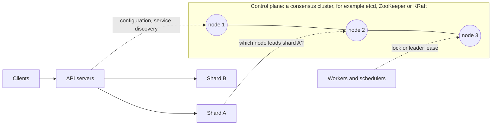

# 01 · Consensus: Raft and Paxos

> Consensus lets a group of machines agree on one ordered sequence of decisions. The group continues to agree while a majority of the machines are alive and can connect to each other.

---

## 1. The problem

Start with a job scheduler that runs on 1 virtual machine (VM). When that VM stops, no jobs run until a person sees the problem. The usual fix is to run a second instance as a standby. Then the problems start:

| Obvious fix | What occurs |
|-------------|-------------|
| The standby takes over when the primary stops its heartbeats. | The primary did not stop. It only paused, for example for a garbage collection pause or a short network fault. Now both instances run jobs, and the billing job runs twice. This is **split brain**. |
| Run both instances. Each instance asks the other instance before it starts a job. | The link between the instances can break. Then each instance must stop, and no jobs run. Or each instance continues alone, and split brain occurs again. 2 nodes cannot see the difference between "the other node stopped" and "I cannot connect to the other node". |
| Store the name of the primary in a database. | Now the database is the single point of failure. If you replicate that database, you have the same problem again, 1 level lower. |

This is the root problem: many machines must agree on a fact, for example the primary or the next write. Each machine can crash. Messages can be lost or delayed, and no machine can know which of these occurred. Consensus algorithms solve this problem. They give you a **replicated log**. Each replica applies the same commands in the same order. After the system commits an entry, the entry never changes.

### What it guarantees

- **Safety:** 2 replicas never commit different entries at the same log position. This stays true when messages are delayed, lost, or arrive in a different order.
- **Liveness:** the system continues to make progress when a majority of the nodes is up and the network is stable enough.
- **Fault tolerance:** a cluster of `2f + 1` nodes survives `f` crashed nodes. 3 nodes survive 1 failure. 5 nodes survive 2 failures.
- **Out of scope:** nodes that lie or attack the system. These are Byzantine faults. They need Byzantine fault tolerance (BFT) protocols, for example Practical Byzantine Fault Tolerance (PBFT), which some blockchains use.

---

## 2. Where it is used in real systems

### Systems that use consensus

| System | What the system agrees on | What breaks without consensus |
|--------|---------------------------|-------------------------------|
| Kubernetes, with etcd | All cluster state: pods, nodes, leases and configuration | 2 controllers act on different views of the cluster. The cluster rolls back state after a component acted on it. |
| Kafka, with KRaft | Cluster metadata: topics, partition leaders and broker membership | 2 brokers both lead a partition and accept writes that diverge. |
| CockroachDB, TiKV and YugabyteDB | Each range of data. Each range is a separate Raft group. | Acknowledged writes are lost when a replica fails. |
| Google Spanner | Each split of data. Each split is a Paxos group. | The same problem. Also, cross-split transactions have no durable coordinator. |
| Consul and Vault | The service catalog, key-value configuration and secrets | Services find instances that are dead or wrong. |
| ZooKeeper, with Zab. HBase and HDFS NameNode failover use it. | The active master, locks and configuration | 2 active NameNodes corrupt the file system namespace. |
| MongoDB replica sets | The primary member, through a Raft-based election | 2 primaries occur, and the system rolls back acknowledged writes. |

**More detail:** [Consensus in real systems](real-world-systems.md) explains each system. It shows what the system is, where consensus is necessary, how the system uses consensus, and the design lesson.

### How to know if a design needs consensus

Ask this question: **if 2 nodes disagree on this fact for a few seconds, what breaks?**

- **The damage is permanent:** a job runs twice, money moves twice, 2 owners write to the same resource, or an acknowledged write disappears. The fact needs agreement. Use consensus, or a tool built on consensus, for example a lease from etcd.
- **The damage is temporary and small:** a count of likes is a little incorrect. Or a feed is a few seconds old, or a "last seen" time is late. Eventual consistency is enough. Consensus adds cost and gives no benefit.

| Fact | Effect of disagreement | Needs consensus? |
|------|------------------------|------------------|
| The primary replica of a database shard | 2 primaries, and the data diverges | Yes |
| The worker that owns a job | The job runs twice | Yes. Usually through a lease on top of consensus. |
| The next unused range of IDs | 2 servers use the same IDs | Yes, but only 1 time for each range |
| The number of likes on a post | The count is incorrect by a few, for a short time | No |
| The "last active" time of a user | The value is a little old | No |

### Where it sits in an architecture

Consensus usually operates in the **control plane**. The control plane is a small cluster that holds the few facts that all other components need. The data plane asks the control plane only sometimes, not for each request.

Sometimes the data itself must be strongly consistent. Then the system divides the data into many small consensus groups. This is **multi-Raft**, and CockroachDB and TiKV use it. With many small groups, no single group becomes the bottleneck.

### What it costs

- **Latency:** each committed decision waits for a round trip to a majority and for a disk flush. In a datacenter, this is about 1 ms. Between continents, it is 100 ms or more.
- **Throughput:** all writes go through 1 leader in each group.
- **Availability:** if a node cannot connect to the majority, it must stop and accept no writes. Consensus gives up availability to stay correct. In the terms of the CAP theorem, consensus is "CP".

Thus, in practice, you **seldom implement consensus yourself**. You select a system that already has consensus, for example etcd, ZooKeeper or a consensus-replicated database. You keep high-volume, eventually consistent data out of that system. Then you design your service around the guarantees and the costs of that system.

---

## 3. Study plan

### Phase A: Foundations

- [ ] **L1. Failure and agreement:** crash faults and Byzantine faults; synchronous and asynchronous networks; partial failure; the intuition behind the Fischer, Lynch and Paterson (FLP) impossibility result; safety and liveness; why 2 majorities always overlap; why 2 nodes, or any even number of nodes, do not help.
- [ ] **L2. Replicated state machines:** a log and a deterministic state machine; the meaning of "committed"; linearizability; the position of consensus in the CAP theorem.

### Phase B: Raft in detail

- [ ] **L3. Leader election:** the follower, candidate and leader roles; terms; `RequestVote`; random election timeouts; split votes; the election restriction, which lets a node vote only for a candidate whose log is at least as up to date as its own log.
- [ ] **L4. Log replication:** `AppendEntries`; the consistency check with `prevLogIndex` and `prevLogTerm`; the log matching property; the commit index; how a leader repairs the logs of followers.
- [ ] **L5. Safety in edge cases:** why a leader counts replicas to commit only entries from its own term, as in Figure 8 of the Raft paper; leader completeness; what occurs to uncommitted entries.
- [ ] **L6. Raft in practice:** snapshots and log compaction; membership changes, with single-server changes or joint consensus; linearizable reads with ReadIndex or lease reads; client retries and deduplication; PreVote and CheckQuorum; learners, which are members without a vote.

### Phase C: Paxos and related protocols

- [ ] **L7. Basic Paxos and Multi-Paxos:** proposers, acceptors and learners; the prepare and promise phase; the accept and accepted phase; why Paxos needs 2 phases; Multi-Paxos, which elects a stable leader and then skips phase 1.
- [ ] **L8. Raft, Paxos, Zab and Viewstamped Replication:** the real differences; why the authors designed Raft; a short overview of EPaxos and Flexible Paxos.

### Phase D: In production

- [ ] **L9. Consensus systems in detail:** read [Consensus in real systems](real-world-systems.md). Then use the APIs of these systems: etcd watches, leases and transactions, and ZooKeeper ephemeral and sequential znodes.
- [ ] **L10. Performance and deployment:** the latency budget, which is a round trip plus an fsync; the leader bottleneck; batching and pipelining; clusters of 3, 5 or 7 nodes; placement across zones and regions; scale-out with multi-Raft.
- [ ] **L11. Failure walkthroughs:** a leader crash; a partition with the old leader on the minority side; a slow disk; a full region outage; a "zombie" old leader that continues to write to external storage. The last case leads to fencing tokens, the next topic.

### Phase E: Design with consensus

- [ ] **L12. Consensus in your own designs:** reuse or build; what to store in the consensus layer and what to keep out; size and placement; how your service must behave on timeouts and when it loses contact with the cluster.
- [ ] **L13. Case studies:** complete each problem in the [design exercises](exercises.md) from start to end.

### Build it in Go

- [ ] **H1.** Use the [Raft simulator](https://raft.github.io/) to watch elections and partitions while you do L3 and L4.
- [ ] **H2.** Build a small Raft with leader election, log replication and partition tests. Use the style of the Raft lab in MIT 6.5840.
- [ ] **H3.** Build a key-value store with 3 nodes on `hashicorp/raft` or `etcd-io/raft`. Then stop nodes and make partitions.

---

## 4. Questions to reason through

- Why use an odd number of nodes? What do 4 nodes give you that 3 nodes do not?
- What occurs when the leader cannot connect to the majority?
- Can 2 nodes both think that they are the leader at the same time? Why is that still safe?
- The write of a client times out. Did the write occur? How must the client retry?
- How can reads skip the log? When can that give stale reads?
- How do you add a node, or replace a dead node, without downtime?
- Why is consensus slow across regions? How do Spanner and CockroachDB decrease that problem?
- How are consensus and two-phase commit (2PC) different? Why does Spanner use both?
- What is split brain? How does a majority prevent it?

---

## 5. Resources, in the order to read them

1. [The Secret Lives of Data: Raft](https://thesecretlivesofdata.com/raft/): an animated introduction of 10 minutes
2. [raft.github.io](https://raft.github.io/): an interactive simulator and links to implementations
3. [Raft paper, extended version](https://raft.github.io/raft.pdf): by Ongaro and Ousterhout, 2014. It is easy to read. Read sections 5 and 6 carefully.
4. *Designing Data-Intensive Applications* by Kleppmann: the chapter "Consistency and Consensus". In the 1st edition, this is chapter 9.
5. [Paxos Made Simple](https://lamport.azurewebsites.net/pubs/paxos-simple.pdf): Lamport, 2001
6. The PhD thesis of Diego Ongaro: membership changes, reads and client sessions, in detail
7. [MIT 6.5840 Distributed Systems](https://pdos.csail.mit.edu/6.824/): the Raft lab uses Go
8. Source code: `etcd-io/raft` and `hashicorp/raft`
