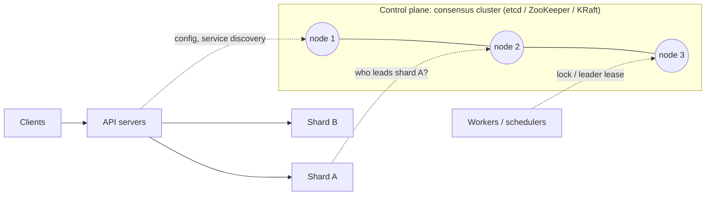

# 01 · Consensus (Raft / Paxos)

> Consensus lets a group of machines agree on a single, ordered sequence of decisions, and keep agreeing as long as a majority of them are alive and can reach each other.

---

## 1. The problem

Take a job scheduler running on one VM. When that VM dies, nothing runs until someone notices. The natural fix is to run a second instance as a standby. That is where the trouble starts:

| Obvious fix | What actually happens |
|-------------|-----------------------|
| The standby takes over when the primary stops answering heartbeats | The primary wasn't dead, just paused (a GC pause, a network blip). Both instances now run jobs, and the billing job runs twice. This is **split brain**. |
| Run both, and have each check with the other before acting | When the link between them breaks, each must either stop (and nothing runs) or carry on alone (split brain again). Two nodes cannot tell "the other node died" apart from "I can't reach it". |
| Store "who is primary" in a database | Now the database is the single point of failure, and replicating *that* database is the same problem one level down. |

The underlying problem is getting several machines to agree on a fact (who the primary is, what the next write is) when any of them can crash and messages can be lost or delayed with no way to tell which. Consensus algorithms solve exactly this. They give you a **replicated log**: every replica applies the same commands in the same order, and once an entry is committed it is never undone.

### What it guarantees

- **Safety:** two replicas never commit different entries at the same log position. This holds no matter how messages are delayed, reordered or lost.
- **Liveness:** the system makes progress whenever a majority is up and the network is stable enough.
- **Fault tolerance:** `2f + 1` nodes survive `f` crashed nodes. 3 nodes survive 1 failure; 5 survive 2.
- **Out of scope:** nodes that lie or are malicious (Byzantine faults). Those need BFT protocols such as PBFT, as used in blockchains.

---

## 2. Where it sits in real systems

### Systems built on it

| System | What it agrees on | What would break without it |
|--------|-------------------|-----------------------------|
| Kubernetes (etcd) | All cluster state: pods, nodes, leases, config | Two controllers act on conflicting views; state that a component already acted on gets rolled back |
| Kafka (KRaft) | Cluster metadata: topics, partition leaders, broker membership | Two brokers both lead a partition and accept diverging writes |
| CockroachDB, TiKV, YugabyteDB | Every range of data (each range is its own Raft group) | Acknowledged writes lost when a replica fails |
| Google Spanner | Every data split (each is a Paxos group) | The same, plus no durable coordinator for cross-split transactions |
| Consul, Vault | Service catalog, KV config, secrets | Services discover dead or wrong instances |
| ZooKeeper (Zab), used by HBase and HDFS NameNode failover | Who the active master is; locks; config | Two active NameNodes corrupt the filesystem namespace |
| MongoDB replica sets | Which member is primary (Raft-based election) | Two primaries; acknowledged writes rolled back |

**Deep dive:** [real-world-systems.md](real-world-systems.md) covers each system: what it is, where consensus comes in, how it's used, and the design lesson to take away.

### Recognising when a design needs it

Ask: **if two nodes disagreed about this fact for a few seconds, what would break?**

- **Something irreversible:** a job runs twice, money moves twice, two owners write to the same resource, an acknowledged write disappears. The fact needs agreement: consensus, or something built on it such as a lease from etcd.
- **Something temporary and harmless:** a like count is slightly off, a feed is a few seconds stale, a "last seen" time lags. Eventual consistency is fine, and consensus would add cost for nothing.

| Fact | Disagreement causes | Needs consensus? |
|------|--------------------|------------------|
| Which replica is primary for a database shard | Two primaries, diverging data | Yes |
| Which worker owns a job | Duplicate execution | Yes (usually a lease on top of it) |
| The next free range of IDs | Duplicate IDs | Yes, but only once per range |
| Number of likes on a post | A count off by a few for a moment | No |
| A user's "last active" timestamp | A slightly stale value | No |

### Where it sits in an architecture

Consensus usually lives in the **control plane**: a small cluster holding the few facts everything else depends on. The data plane asks it questions occasionally rather than on every request. When the data itself must be strongly consistent, it is split into many small consensus groups (**multi-Raft**, as in CockroachDB and TiKV) so no single group becomes the bottleneck.

### What it costs

- **Latency:** every committed decision waits for a round trip to a majority plus a disk flush. That's about a millisecond within a datacenter and 100 ms or more across continents.
- **Throughput:** all writes go through one leader per group.
- **Availability:** a node cut off from the majority must stop accepting writes. Consensus deliberately gives up availability to stay correct (it is "CP" in CAP terms).

So in practice you **rarely implement consensus yourself**. You pick a system that already has it (etcd, ZooKeeper, a consensus-replicated database), keep high-volume, eventually consistent data out of it, and design your service around its guarantees and costs.

---

## 3. Learning path

### Phase A: Foundations
- [ ] **L1. Failure and agreement:** crash vs Byzantine faults, synchronous vs asynchronous networks, partial failure, FLP impossibility (the intuition), safety vs liveness, why majorities always overlap, why 2 nodes (or any even number) don't help.
- [ ] **L2. Replicated state machines:** a log plus a deterministic state machine, what "committed" means, linearizability, and where consensus sits in CAP.

### Phase B: Raft in depth
- [ ] **L3. Leader election:** follower / candidate / leader roles, terms, `RequestVote`, randomized election timeouts, split votes, the "most up-to-date log" voting rule.
- [ ] **L4. Log replication:** `AppendEntries`, the `prevLogIndex`/`prevLogTerm` consistency check, the log matching property, commit index, how a leader repairs follower logs.
- [ ] **L5. Safety corner cases:** why a leader only commits entries from its *own* term by counting replicas (the paper's "Figure 8"), leader completeness, what happens to uncommitted entries.
- [ ] **L6. Making Raft practical:** snapshots and log compaction, membership changes (single-server changes vs joint consensus), linearizable reads (ReadIndex, lease reads), client retries and deduplication, PreVote and CheckQuorum, learners (non-voting members).

### Phase C: Paxos and relatives
- [ ] **L7. Basic Paxos and Multi-Paxos:** proposers, acceptors, learners; prepare/promise and accept/accepted; why two phases are needed; Multi-Paxos as "elect a stable leader, then skip phase 1".
- [ ] **L8. Raft vs Paxos vs Zab vs Viewstamped Replication:** what actually differs, why Raft was designed, and a brief look at EPaxos and Flexible Paxos.

### Phase D: In production
- [ ] **L9. Consensus systems up close:** read [real-world-systems.md](real-world-systems.md), then go hands-on with the APIs these systems expose: etcd watches, leases and transactions; ZooKeeper ephemeral and sequential znodes.
- [ ] **L10. Performance and deployment:** latency budget (round trip + fsync), the leader bottleneck, batching and pipelining, 3 vs 5 vs 7 nodes, placement across zones and regions, scaling out with multi-Raft.
- [ ] **L11. Failure walkthroughs:** leader crash; partition with the old leader on the minority side; slow disk; full region outage; a "zombie" ex-leader still writing to external storage (which leads into fencing tokens, the next topic).

### Phase E: Designing with it
- [ ] **L12. Using consensus in your own designs:** reuse vs build; what to store in the consensus layer and what to keep out; sizing and placement; how your service should behave on timeouts and when it loses contact with the cluster.
- [ ] **L13. Case studies:** work through [exercises.md](exercises.md) end to end.

### Build it (Go)
- [ ] **H1.** Watch elections and partitions in the [Raft simulator](https://raft.github.io/) while doing L3–L4.
- [ ] **H2.** Build a toy Raft (leader election + log replication) with partition tests, in the style of MIT 6.5840's Raft lab.
- [ ] **H3.** Build a 3-node KV store on `hashicorp/raft` or `etcd-io/raft`, then kill nodes and partition it.

---

## 4. Questions you should be able to reason through

- Why an odd number of nodes? What does a 4th node buy you over 3?
- What happens when the leader is cut off from the majority?
- Can two nodes believe they're leader at the same time? Why is that still safe?
- A client's write times out. Did it happen? How should the client retry?
- How can reads skip the log, and when does that risk stale reads?
- How do you add a node or replace a dead one without downtime?
- Why is consensus slow across regions, and how do Spanner and CockroachDB cope?
- How do consensus and 2PC differ, and why does Spanner use both?
- What is split brain, and exactly how does a majority prevent it?

---

## 5. Resources (in reading order)

1. [The Secret Lives of Data: Raft](https://thesecretlivesofdata.com/raft/): a 10-minute animated intro
2. [raft.github.io](https://raft.github.io/): an interactive simulator plus links to implementations
3. [Raft paper (extended version)](https://raft.github.io/raft.pdf): Ongaro & Ousterhout, 2014. Readable; focus on sections 5 and 6.
4. *Designing Data-Intensive Applications* (Kleppmann), chapter "Consistency and Consensus" (ch. 9 in the 1st edition)
5. [Paxos Made Simple](https://lamport.azurewebsites.net/pubs/paxos-simple.pdf): Lamport, 2001
6. Diego Ongaro's PhD thesis: membership changes, reads and client sessions in depth
7. [MIT 6.5840 Distributed Systems](https://pdos.csail.mit.edu/6.824/): the Raft lab is in Go
8. Source code: `etcd-io/raft`, `hashicorp/raft`
