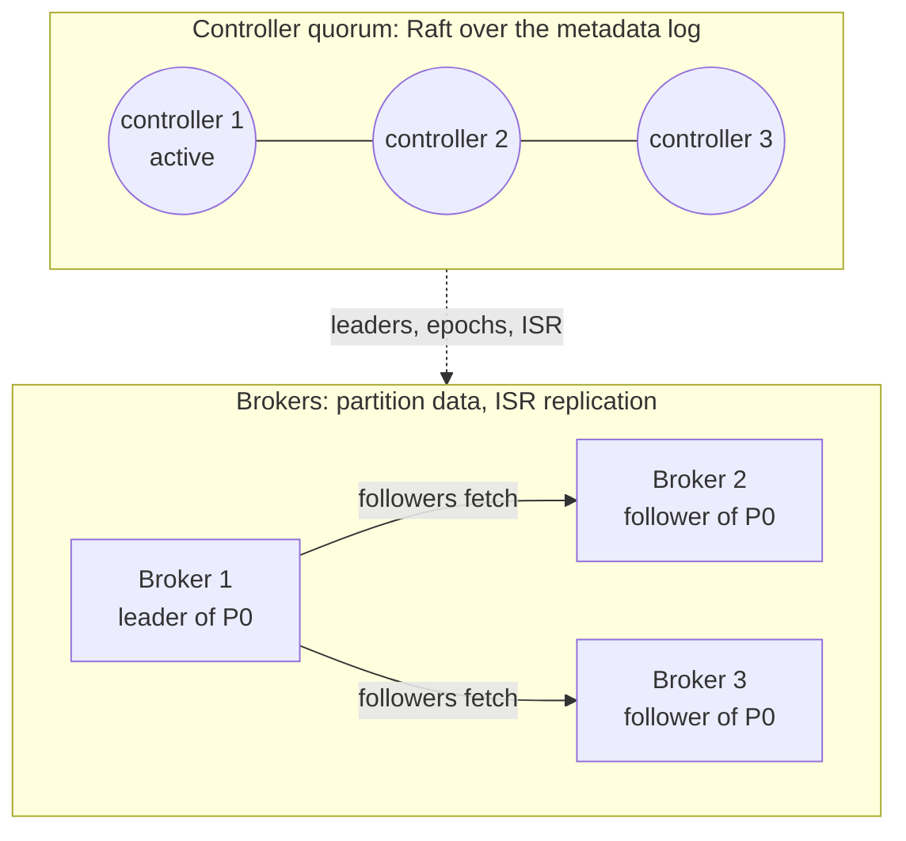
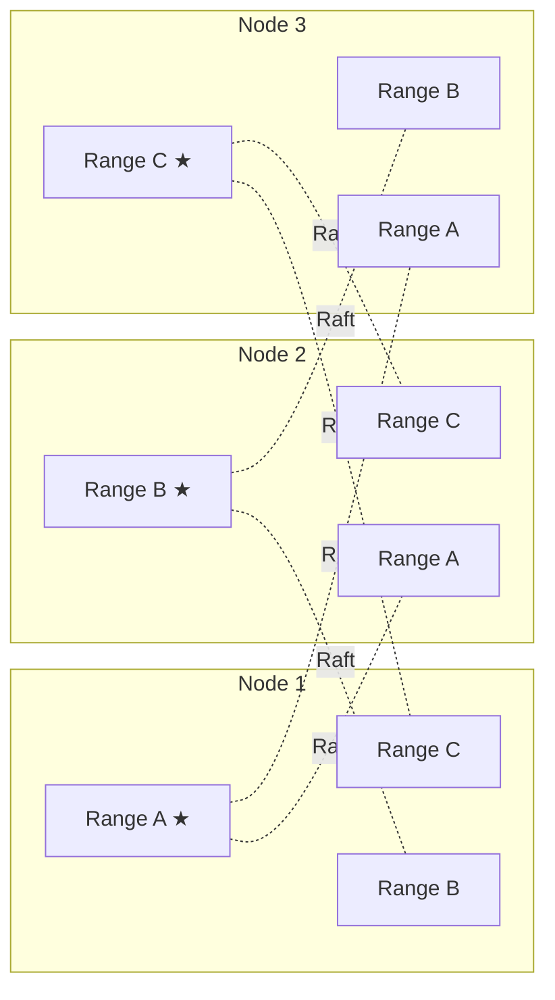

# Consensus in Real Systems

How production systems use consensus. For each system: what it is, where agreement is needed, and how consensus provides it. The **design lesson** at the end of each section is the part to carry into your own designs.

## Three ways systems use consensus

| Style | The idea | Examples |
|-------|----------|----------|
| **Coordination service** | A separate, small cluster stores the critical facts; other systems ask it | etcd (Kubernetes), ZooKeeper (HBase, HDFS), Consul |
| **Built-in metadata quorum** | The system runs its own consensus group only for metadata; the data itself is replicated more cheaply | Kafka (KRaft), TiDB's PD |
| **Consensus per shard** | Every shard of data is its own consensus group, so every write goes through consensus | CockroachDB, TiKV, Spanner, DynamoDB |

Some systems deliberately keep consensus **off** the data path. They're covered in Part 4, because seeing why they avoid it teaches as much as seeing where it's used.

---

## Part 1: Coordination services

### etcd and Kubernetes

**What it is.** Kubernetes runs containers across a cluster of machines. Its control plane (API server, scheduler, controller manager) is stateless. All cluster state, meaning every pod, node, deployment and secret, lives in **etcd**: a key-value store replicated with Raft, usually across 3 or 5 members.

**Where consensus comes in.**
- Cluster state needs a single truth. If two API servers saw different versions of a Deployment, controllers would fight over it.
- Only one scheduler and one controller manager may be active at a time, even though several replicas run for high availability.

**How it's used.**
- **Every write is a Raft commit.** Each change through the API server is an etcd write committed by a majority.
- **Optimistic concurrency.** Every object carries a `resourceVersion` (etcd's revision number), and updates are compare-and-swap on it: "update this pod only if it's still at version 4182". When two controllers race, one wins and the other re-reads and retries.
- **Watches.** Controllers subscribe to changes from a given revision. Because the log is totally ordered, every watcher sees the same changes in the same order, with no gaps.
- **Leader election.** Scheduler and controller-manager replicas compete to hold a `Lease` object, and the holder renews it every few seconds. If it stops renewing, another replica takes over once the lease expires. The Lease is just an etcd key, so "who is leader" is decided by consensus.
- **When etcd loses quorum,** the cluster can't accept changes, but running containers keep running. Nodes don't need etcd to keep serving traffic.

**Design lesson.** Keep the consensus store small, and make the data plane independent of it. etcd is sized in gigabytes, not terabytes: it holds metadata, not application data. A Kubernetes cluster rides out an etcd outage for a while precisely because nothing on the request path depends on it.

---

### ZooKeeper (used by HBase, HDFS, and formerly Kafka)

**What it is.** A coordination service originally from Yahoo. It stores a tree of small nodes (**znodes**) replicated across an ensemble of 3 or 5 servers using **Zab** (ZooKeeper Atomic Broadcast), a leader-based protocol in the same family as Raft and Multi-Paxos. It isn't a database; it provides primitives you build coordination from.

**Where consensus comes in.** Every write is ordered by the leader and committed by a majority, so every client sees the same history.

**How it's used.** Three primitives do most of the work:
- **Ephemeral znodes** disappear when the client's session ends (it stops heartbeating). That gives you ownership tied to a live process.
- **Sequential znodes** get a monotonically increasing number appended. That gives you fair queues and locks: the lowest number holds the lock, and each waiter watches only the node just ahead of it, so a release doesn't wake everyone.
- **Watches** notify a client when a znode changes.

Real uses:
- **HBase:** the active master is whoever first creates the ephemeral `/hbase/master` node. Each RegionServer registers an ephemeral node too; when one vanishes, the master reassigns that server's regions.
- **HDFS NameNode HA:** a failover controller next to each NameNode competes for an ephemeral lock znode, and the winner's NameNode becomes active. Separately, the NameNode's edit log is written to a quorum of **JournalNodes** (a majority must acknowledge) with epoch numbers, so an old active NameNode can't keep writing after it has been replaced. That is consensus-style quorums plus fencing on the data path.
- **Kafka** stored its metadata in ZooKeeper until KRaft replaced it. **ClickHouse** replaced ZooKeeper with ClickHouse Keeper, a Raft-based service with a compatible API.

**Design lesson.** Consensus systems expose a handful of primitives: sessions, ephemeral ownership, ordered sequence numbers and watches. Locks, leader election, membership and config distribution are all built from them. In your own designs, think in terms of the primitive you need, not "add ZooKeeper".

---

### Consul (and Vault)

**What it is.** HashiCorp's service discovery and configuration system. A few Consul **servers** (3 or 5) hold the service catalog, health status and KV store in a Raft cluster. Every machine runs a lightweight **client agent**.

**Where consensus comes in.** The catalog, the KV config and the locks must be consistent. But tracking the liveness of thousands of machines through Raft would overwhelm it.

**How it's used.**
- **Two layers.** Raft among the servers holds the state. **Gossip** among all agents (a SWIM-based protocol) handles membership and failure detection. Gossip discovers that a node has gone, and the servers record that fact through Raft.
- **The caller chooses read freshness.** *Default* reads come from the leader and are fast, but can be very slightly stale during a leader change. *Consistent* reads make the leader confirm with a quorum first. *Stale* reads let any server answer, which scales reads but may lag.
- **Vault** (secrets management) can store its data in Consul or in its built-in "integrated storage", which is also Raft.

**Design lesson.** Use consensus for the small set of facts that must be right, and gossip for the large, fast-changing, approximate ones. Let callers choose read freshness, because not every read needs a quorum.

---

## Part 2: Built-in metadata quorum

### Kafka (KRaft)

**What it is.** A distributed, append-only log. Topics are split into partitions, and each partition is replicated across several brokers.

**Where consensus comes in.** Cluster metadata: which brokers are alive, which topics and partitions exist, which broker leads each partition, and which replicas are in sync. If two brokers both believed they led the same partition, producers would write diverging data.

**How it's used.**

- **A small controller quorum** (3 or 5 nodes) runs Raft over a metadata log. The Raft leader is the active controller, and brokers replicate the metadata log and act on it. Since Kafka 4.0 (March 2025), this is the only mode; ZooKeeper support has been removed.
- **Partition data is *not* replicated with Raft.** Each partition has a leader, and followers fetch from it. The leader tracks the **in-sync replicas (ISR)**. With `acks=all` and `min.insync.replicas=2`, a write is acknowledged once every in-sync replica has it.
- **Failover is decided by consensus.** When a partition leader dies, the controller picks a new leader from the ISR and bumps the partition's **leader epoch**. The old leader's epoch is now stale, so its requests are rejected. That's fencing.
- **Why not Raft for the data too?** ISR replication can keep data safe with fewer copies, because the set of trusted replicas is itself maintained by consensus. The controller is the single arbiter of who's in sync.

**Design lesson.** You don't need consensus on every byte. Put consensus on *who's in charge* (membership, leadership, epochs) and use cheaper replication for the bulk data, made safe by those decisions.

---

## Part 3: Consensus per shard

### CockroachDB

**What it is.** A distributed SQL database (Postgres-compatible wire protocol) built to survive node, zone and region failures, with serializable transactions.

**Where consensus comes in.** Every write to user data. No acknowledged write may be lost, and every reader must see a consistent state.

**How it's used.**

*Each range is its own Raft group (★ = leader / leaseholder). Leaders are spread across nodes so every node shares the work.*

- **Multi-Raft.** The keyspace is split into **ranges** (512 MiB by default), and each range is replicated 3 times by default as its own Raft group. A cluster holding terabytes runs tens of thousands of independent Raft groups.
- **Leaseholder.** One replica per range holds a lease. It serves reads directly, with no Raft round trip, and proposes all writes. It is the same replica as the Raft leader.
- **Writes** are appended to the range's Raft log and committed once a majority acknowledges them.
- **Cross-range transactions.** A transaction's status lives in a transaction record stored in one of the ranges it touches. Committing means writing that record, which is itself Raft-replicated, so the "coordinator" can't be lost the way a classic 2PC coordinator can.
- **Placement.** Zone configurations pin replicas and leaseholders to particular regions, for example keeping a European customer's leaseholder in Europe.
- **The cost shows up in production.** Every Raft group does background work even when idle, so the number of ranges per node becomes a CPU scaling limit.

**Design lesson.** Scale consensus out by sharding into many small groups. Let a lease-holding leader serve reads, so reads skip consensus. Expect a per-group overhead.

---

### TiDB / TiKV

**What it is.** TiDB is a MySQL-compatible distributed SQL database. Its SQL layer is stateless, and the data lives in **TiKV**, a distributed key-value store.

**Where consensus comes in.** In two separate places: the data itself, and the metadata about where that data lives.

**How it's used.**
- **Data:** TiKV splits data into **Regions**, each its own Raft group. This is the same multi-Raft idea as CockroachDB.
- **Metadata:** the **Placement Driver (PD)** tracks where every Region lives, splits and moves Regions to balance load, and hands out globally ordered timestamps for transactions. PD embeds etcd, so its own state and leader election are Raft-backed.
- **Transactions** use a Percolator-style two-phase commit across Regions, ordered by timestamps from PD.

**Design lesson.** Both styles in one system: per-shard consensus for data, plus a consensus-backed metadata service for placement and global ordering. A single global timestamp source is simple and correct, but every transaction has to reach it.

---

### Google Spanner

**What it is.** Google's globally distributed SQL database, offering externally consistent transactions across regions.

**Where consensus comes in.** Replicating each piece of data across zones or regions without ever losing a write, and keeping transactions that span many shards correct when machines fail mid-transaction.

**How it's used.**
- **Paxos groups.** Data is divided into **splits**, and each split is replicated across zones or regions as a Paxos group. Each group has a long-lived leader holding a time-based lease.
- **Writes** go to the leader and commit when a majority acknowledges them. Across regions, that round trip is the latency floor, so Spanner's configurations choose where voting replicas live to keep a majority close together.
- **Cross-split transactions use 2PC, but every participant is a Paxos group,** not a single machine. If a leader dies mid-transaction, another replica of its group takes over with the transaction state intact. That removes 2PC's classic weakness of blocking when the coordinator dies.
- **TrueTime.** GPS receivers and atomic clocks give each machine a bounded time interval. Spanner waits out that uncertainty before committing ("commit wait"), so timestamps match real-time order. Reads at a past timestamp can then be served by any up-to-date replica without consensus.

**Design lesson.** Consensus and 2PC solve different problems and compose well: consensus makes each participant fault-tolerant, and 2PC makes the transaction atomic across participants. Where the majority sits decides your write latency.

---

### MongoDB replica sets

**What it is.** A document database. A replica set is usually 3 members: one primary and secondaries that copy its operation log (the **oplog**).

**Where consensus comes in.** Deciding who the primary is, and whether a write survives a failover.

**How it's used.**
- **Elections** use a Raft-inspired protocol with terms, votes and majorities.
- **Secondaries pull the oplog** from the primary.
- **Write concern decides durability.** With `w: 1`, a write is acknowledged once the primary has it. If the primary dies before replicating it, the new primary never sees that write, and the old primary **rolls it back** when it rejoins. With `w: "majority"`, the write is acknowledged only once a majority has it, so it survives any single failover. Read concerns (`"majority"`, `"linearizable"`) are the equivalent choice for reads.

**Design lesson.** "It uses consensus" doesn't by itself make your write safe; the acknowledgment rule does. Consensus only protects what a majority has. Acknowledging earlier trades durability for latency.

---

### Amazon DynamoDB

**What it is.** AWS's managed key-value and document database. Tables are split into partitions automatically.

**Where consensus comes in.** The replicas of each partition must agree on which one accepts writes.

**How it's used** (as described in AWS's 2022 USENIX ATC paper on DynamoDB):
- **Each partition** has 3 replicas in different availability zones, forming a replication group that uses **Multi-Paxos** to elect a leader.
- **Only the leader** serves writes and strongly consistent reads. A write is acknowledged once its log record is persisted by a quorum of replicas (2 of 3).
- **The leader holds a lease** that it keeps renewing. **Eventually consistent reads** can go to any replica: they cost half as much but may be slightly stale.
- **Careful failure detection.** A replica that suspects the leader has failed first asks the other replicas whether they can still reach it. This avoids needless elections caused by "gray" failures, where only one network link is bad.

**Design lesson.** Even a system known for availability runs consensus inside every partition. Offer callers a choice of read consistency, priced accordingly.

---

## Part 4: Where systems avoid consensus, and why

### Cassandra

**What it is.** A leaderless, wide-column database. Any replica can accept a write, and consistency is tuned per request with quorums (topic 03). Conflicting writes are resolved by timestamp, last write wins.

**Why no consensus on writes.** Every node stays writable, even across regions and during partitions. The cost: two concurrent writes to the same key can silently lose one.

**Where it does use consensus.** **Lightweight transactions** (`INSERT ... IF NOT EXISTS`, `UPDATE ... IF`) run Paxos on that partition. They take several round trips, so they're reserved for operations that must be unique, such as claiming a username.

**Design lesson.** Default to eventual consistency, and pay for consensus only on the few operations where uniqueness matters.

---

### Redis (replication + Sentinel)

**What it is.** An in-memory data store. A primary replicates **asynchronously** to its replicas, and **Sentinel** processes watch the primary and handle failover.

**How agreement is used.** Sentinels agree, by quorum, that the primary is down, then elect one Sentinel to carry out the failover. So *who is primary* is decided by agreement, but replicating the data never waits for it.

**What that costs.** Writes the old primary acknowledged but hadn't yet replicated are lost on failover. During a network partition, an isolated primary can keep accepting writes that are later discarded. `min-replicas-to-write` narrows that window but doesn't close it.

**Design lesson.** Agreeing on the leader isn't enough. If acknowledgments don't wait for a majority, acknowledged writes can disappear. That's fine for a cache and unacceptable for a ledger.

---

## Patterns across all of these

| Lesson | Seen in |
|--------|---------|
| Keep the consensus store small; keep the data plane independent of it | Kubernetes/etcd, ZooKeeper users |
| Put consensus on leadership and epochs; replicate bulk data more cheaply | Kafka, HDFS |
| Scale out by splitting data into many small consensus groups | CockroachDB, TiKV, Spanner, DynamoDB |
| Use a leader lease to serve reads without a consensus round trip | CockroachDB, Spanner, DynamoDB |
| The acknowledgment rule, not the election protocol, decides durability | MongoDB, Redis |
| Combine consensus with 2PC for atomic cross-shard transactions | Spanner, CockroachDB, TiDB |
| Use consensus where uniqueness matters, something cheaper elsewhere | Cassandra LWT, Consul (Raft + gossip) |

---

## Think it through

1. etcd loses quorum. Which parts of a Kubernetes cluster keep working, and which stop? Why was it designed that way?
2. Kafka replicates partition data with ISR but metadata with Raft. What would go wrong if the controller's own metadata were replicated the ISR way?
3. Walk step by step through how a MongoDB write acknowledged with `w: 1` gets lost. What exactly changes with `w: "majority"`?
4. Raft already has a leader. Why does CockroachDB also need a *lease* before serving reads locally?
5. Your service needs "only one worker processes each job". Which primitive from this page would you build it on, and what happens when that worker freezes for 30 seconds?
