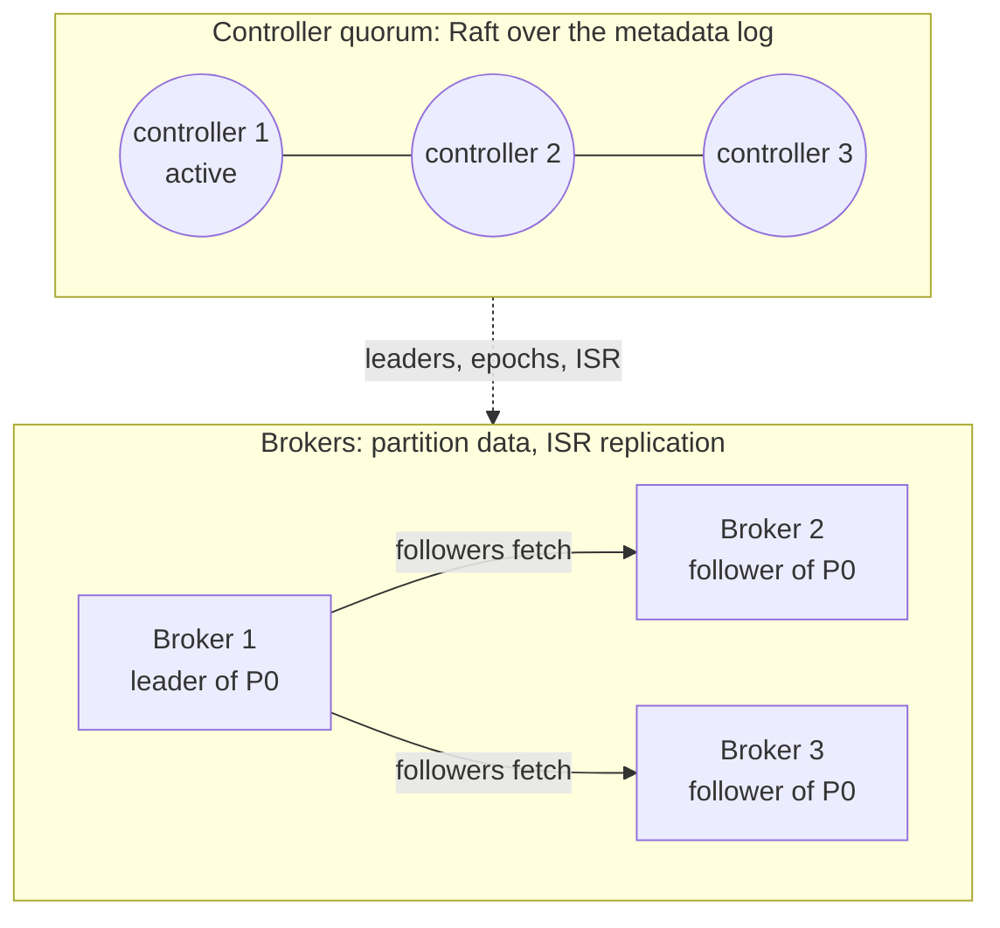
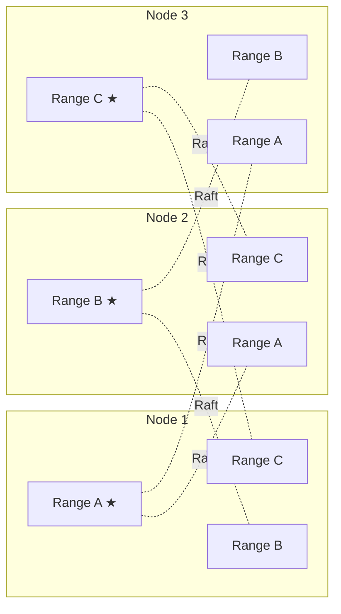

# Consensus in Real Systems

This page shows how production systems use consensus. For each system, it gives 4 items: what the system is, where it needs agreement, how consensus gives that agreement, and a **design lesson**. Use the design lessons in your own designs.

## 3 ways that systems use consensus

| Style | The idea | Examples |
|-------|----------|----------|
| **Coordination service** | A separate small cluster stores the critical facts. Other systems ask that cluster. | etcd for Kubernetes, ZooKeeper for HBase and HDFS, Consul |
| **Built-in metadata quorum** | The system runs its own consensus group only for metadata. It replicates the data with a less expensive method. | Kafka with KRaft, the Placement Driver of TiDB |
| **Consensus per shard** | Each shard of data is a separate consensus group. Thus each write goes through consensus. | CockroachDB, TiKV, Spanner, DynamoDB |

Some systems keep consensus **off** the data path on purpose. Part 4 shows these systems. Their reasons teach as much as the systems that use consensus.

---

## Part 1: Coordination services

### etcd and Kubernetes

**What it is.** Kubernetes runs containers on a cluster of machines. Its control plane has an API server, a scheduler and a controller manager, and these components are stateless. All cluster state is in **etcd**: each pod, node, deployment and secret. etcd is a key-value store that Raft replicates, usually across 3 or 5 members.

**Where consensus is necessary.**

- The cluster state needs 1 single truth. If 2 API servers saw different versions of a Deployment, the controllers would fight over it.
- Only 1 scheduler and 1 controller manager can be active at a time. But many replicas of each component run, for high availability.

**How Kubernetes uses it.**

- **Each write is a Raft commit.** Each change through the API server is an etcd write that a majority commits.
- **Optimistic concurrency.** Each object has a `resourceVersion`, which is the etcd revision number. An update is a compare-and-swap on that number. Example: "update this pod only if it is still at version 4182". When 2 controllers race, one controller wins. The other controller reads the object again and retries.
- **Watches.** Controllers subscribe to changes from a given revision. The log has a total order, so each watcher sees the same changes in the same order, with no gaps.
- **Leader election.** The replicas of the scheduler and the controller manager compete to hold a `Lease` object. The holder renews the lease every few seconds. If the holder stops the renewals, another replica takes over when the lease expires. The Lease is only an etcd key, so consensus decides which replica is the leader.
- **When etcd loses quorum,** the cluster cannot accept changes. But the containers continue to run. Nodes do not need etcd to continue to serve traffic.

**Design lesson.** Keep the consensus store small, and make the data plane independent of it. Engineers size etcd in gigabytes, not terabytes, because it holds metadata, not application data. A Kubernetes cluster can survive an etcd outage for some time, because no component on the request path needs etcd.

---

### ZooKeeper: used by HBase, HDFS and, before KRaft, Kafka

**What it is.** A coordination service that Yahoo first developed. It stores a tree of small nodes, which are named **znodes**. An ensemble of 3 or 5 servers replicates the tree with **Zab**, the ZooKeeper Atomic Broadcast protocol. Zab is a leader-based protocol in the same family as Raft and Multi-Paxos. ZooKeeper is not a database. It gives primitives, and you build coordination from them.

**Where consensus is necessary.** The leader puts each write in order, and a majority commits it. Thus each client sees the same history.

**How systems use it.** 3 primitives do most of the work:

- **Ephemeral znodes** disappear when the session of the client ends, because the client stops its heartbeats. This gives ownership that is tied to a live process.
- **Sequential znodes** get a number that always increases. This gives fair queues and fair locks. The lowest number holds the lock. Each waiter watches only the node just before it, so a release does not wake all the waiters.
- **Watches** tell a client when a znode changes.

Real uses:

- **HBase:** the first process that creates the ephemeral `/hbase/master` node becomes the active master. Each RegionServer also registers an ephemeral node. When that node disappears, the master gives the regions of that server to other servers.
- **HDFS NameNode high availability (HA):** each NameNode has a failover controller near it. The failover controllers compete for an ephemeral lock znode, and the NameNode of the winner becomes active. Also, the NameNode writes its edit log to a quorum of **JournalNodes**, and a majority must acknowledge each write. The JournalNodes use epoch numbers. Thus an old active NameNode cannot continue to write after the system replaces it. This is a consensus-style quorum, plus fencing, on the data path.
- **Kafka** stored its metadata in ZooKeeper until KRaft replaced it. **ClickHouse** replaced ZooKeeper with ClickHouse Keeper. ClickHouse Keeper is a Raft-based service with a compatible API.

**Design lesson.** Consensus systems give a small set of primitives: sessions, ephemeral ownership, ordered sequence numbers and watches. You can build locks, leader election, membership and configuration distribution from them. In your own designs, find the primitive that you need. Do not simply "add ZooKeeper".

---

### Consul and Vault

**What it is.** Consul is the service discovery and configuration system from HashiCorp. A few Consul **servers**, usually 3 or 5, hold the service catalog, the health status and the key-value store in a Raft cluster. Each machine runs a lightweight **client agent**.

**Where consensus is necessary.** The catalog, the key-value configuration and the locks must be consistent. But Raft cannot easily track the liveness of thousands of machines, because the load is too high.

**How Consul uses it.**

- **2 layers.** Raft on the servers holds the state. **Gossip** among all the agents handles membership and failure detection. The gossip protocol is based on SWIM. Gossip finds that a node is gone, and then the servers record that fact through Raft.
- **The caller selects the freshness of a read.** *Default* reads come from the leader and are fast. But during a leader change, they can be a little stale. *Consistent* reads make the leader confirm its position with a quorum first. *Stale* reads let any server answer. These reads scale, but they can be old.
- **Vault**, the secrets manager from HashiCorp, can store its data in Consul. It can also use its built-in "integrated storage", which also uses Raft.

**Design lesson.** Use consensus for the small set of facts that must be correct. Use gossip for the large set of facts that change quickly and can be approximate. Let callers select the freshness of reads, because not every read needs a quorum.

---

## Part 2: Built-in metadata quorum

### Kafka with KRaft

**What it is.** A distributed log, to which you can only append. Kafka divides topics into partitions, and it replicates each partition across many brokers.

**Where consensus is necessary.** In the cluster metadata: which brokers are alive, which topics and partitions exist, which broker leads each partition, and which replicas are in sync. If 2 brokers both thought that they led the same partition, producers would write data that diverges.

**How Kafka uses it.**

- **A small controller quorum** of 3 or 5 nodes runs Raft over a metadata log. The Raft leader is the active controller. Brokers replicate the metadata log and act on it. Since Kafka 4.0 in March 2025, this is the only mode. Kafka 4.0 removed the support for ZooKeeper.
- **Kafka does *not* use Raft to replicate partition data.** Each partition has a leader, and the followers fetch from it. The leader tracks the **in-sync replicas (ISR)**. With `acks=all` and `min.insync.replicas=2`, the leader acknowledges a write when each in-sync replica has the write.
- **Consensus decides failover.** When a partition leader stops, the controller selects a new leader from the ISR. It also increments the **leader epoch** of the partition. The epoch of the old leader is now stale, so the brokers reject its requests. This is fencing.
- **Why not use Raft for the data too?** ISR replication can keep data safe with fewer copies, because consensus controls the set of trusted replicas. The controller is the only authority that decides which replicas are in sync.

**Design lesson.** You do not need consensus on each byte. Use consensus to decide *who is in charge*: membership, leadership and epochs. Then use less expensive replication for the bulk data. Those decisions make the bulk replication safe.

---

## Part 3: Consensus per shard

### CockroachDB

**What it is.** A distributed SQL database that uses the Postgres wire protocol. Its design survives failures of nodes, zones and regions, and it gives serializable transactions.

**Where consensus is necessary.** For each write to user data. The system must never lose an acknowledged write, and each reader must see a consistent state.

**How CockroachDB uses it.**

*Each range is a separate Raft group. The ★ shows the leader, which is also the leaseholder. The leaders are on different nodes, so all the nodes share the work.*

- **Multi-Raft.** CockroachDB divides the keyspace into **ranges**. The default size of a range is 512 MiB. By default, the system replicates each range 3 times, and each range is a separate Raft group. A cluster with terabytes of data runs tens of thousands of independent Raft groups.
- **Leaseholder.** 1 replica of each range holds a lease. It serves reads directly, with no Raft round trip, and it proposes all writes. It is the same replica as the Raft leader.
- **Writes.** The leader appends each write to the Raft log of the range. The write commits when a majority acknowledges it.
- **Cross-range transactions.** A transaction record holds the status of the transaction. This record is in one of the ranges that the transaction touches. To commit, the system writes that record. Raft replicates the record, so the system cannot lose the "coordinator". A classic two-phase commit (2PC) coordinator can be lost.
- **Placement.** Zone configurations keep replicas and leaseholders in specified regions. Example: keep the leaseholder for a European customer in Europe.
- **The cost in production.** Each Raft group does background work, also when it is idle. Thus the number of ranges on each node becomes a limit on CPU.

**Design lesson.** To scale consensus, divide the data into many small groups. Let a leader with a lease serve reads, so reads skip consensus. Expect an overhead for each group.

---

### TiDB and TiKV

**What it is.** TiDB is a distributed SQL database that is compatible with MySQL. Its SQL layer is stateless. The data is in **TiKV**, a distributed key-value store.

**Where consensus is necessary.** In 2 separate places: the data, and the metadata that shows where the data is.

**How TiDB uses it.**

- **Data:** TiKV divides data into **Regions**, and each Region is a separate Raft group. This is the same multi-Raft idea as in CockroachDB.
- **Metadata:** the **Placement Driver (PD)** records where each Region is. It splits and moves Regions to balance the load. It also gives globally ordered timestamps to transactions. PD contains etcd, so Raft keeps its state and does its leader election.
- **Transactions** use a two-phase commit across Regions, in the style of Percolator. The timestamps from PD put the transactions in order.

**Design lesson.** This system uses both styles: consensus per shard for the data, and a metadata service on consensus for placement and global order. A single global timestamp source is simple and correct. But each transaction must connect to it.

---

### Google Spanner

**What it is.** The globally distributed SQL database from Google. It gives externally consistent transactions across regions.

**Where consensus is necessary.** In 2 places. Spanner replicates each piece of data across zones or regions, and it must never lose a write. Also, transactions across many shards must stay correct when machines fail during the transaction.

**How Spanner uses it.**

- **Paxos groups.** Spanner divides data into **splits**. It replicates each split across zones or regions as a Paxos group. Each group has a leader that lives for a long time and holds a lease based on time.
- **Writes** go to the leader. A write commits when a majority acknowledges it. Across regions, that round trip sets the minimum latency. Thus Spanner configurations select where the replicas that vote are, to keep a majority near each other.
- **Cross-split transactions use 2PC, but each participant is a Paxos group,** not a single machine. If a leader stops during a transaction, another replica in its group takes over. The transaction state stays complete. This removes the classic weakness of 2PC: it blocks when the coordinator stops.
- **TrueTime.** GPS receivers and atomic clocks give each machine a time interval with a known limit. Before Spanner commits, it waits for the duration of that uncertainty. This wait is "commit wait". Thus the timestamps agree with the real-time order. Then any replica that is up to date can serve reads at a past timestamp, without consensus.

**Design lesson.** Consensus and 2PC solve different problems, and they work well together. Consensus makes each participant fault-tolerant. 2PC makes the transaction atomic across participants. The location of the majority decides your write latency.

---

### MongoDB replica sets

**What it is.** A document database. A replica set usually has 3 members: 1 primary, and secondaries that copy the operation log of the primary. This log is the **oplog**.

**Where consensus is necessary.** To decide which member is the primary, and if a write survives a failover.

**How MongoDB uses it.**

- **Elections** use a protocol based on Raft, with terms, votes and majorities.
- **Secondaries pull the oplog** from the primary.
- **Write concern decides durability.** With `w: 1`, the primary acknowledges a write when it has the write. If the primary stops before it replicates the write, the new primary never sees that write. When the old primary joins again, it **rolls back** the write. With `w: "majority"`, the system acknowledges the write only when a majority has it. Thus the write survives any single failover. Read concerns, for example `"majority"` and `"linearizable"`, give the same choice for reads.

**Design lesson.** "It uses consensus" does not make your write safe. The rule for acknowledgment makes it safe. Consensus protects only the data that a majority has. If you acknowledge earlier, you get less latency but also less durability.

---

### Amazon DynamoDB

**What it is.** The managed key-value and document database from AWS. DynamoDB divides tables into partitions automatically.

**Where consensus is necessary.** The replicas of each partition must agree on which replica accepts writes.

**How DynamoDB uses it.** The 2022 USENIX ATC paper from AWS gives this description:

- **Each partition** has 3 replicas in different availability zones. The replicas make a replication group, which uses **Multi-Paxos** to elect a leader.
- **Only the leader** serves writes and strongly consistent reads. The leader acknowledges a write when a quorum of replicas, 2 of 3, writes the log record to storage.
- **The leader holds a lease** and renews it continuously. **Eventually consistent reads** can go to any replica. They cost half as much, but they can be a little stale.
- **Careful failure detection.** A replica can think that the leader failed. Then it first asks the other replicas if they can still connect to the leader. This prevents unnecessary elections that "gray" failures cause. In a gray failure, only 1 network link is bad.

**Design lesson.** Even a system that is famous for availability runs consensus in each partition. Let callers select the consistency of reads, and set the price to match.

---

## Part 4: Where systems do not use consensus, and why

### Cassandra

**What it is.** A leaderless, wide-column database. Any replica can accept a write. Each request sets its own consistency level with quorums, as topic 03 explains. Cassandra resolves writes that conflict by timestamp: the last write wins.

**Why there is no consensus on writes.** Each node can always accept writes, also across regions and during partitions. The cost: if 2 writes to the same key occur at the same time, Cassandra can lose one of them with no error.

**Where it uses consensus.** **Lightweight transactions** run Paxos on the partition. Examples are `INSERT ... IF NOT EXISTS` and `UPDATE ... IF`. They need many round trips. Thus you use them only for operations that must be unique, for example to claim a username.

**Design lesson.** Use eventual consistency by default. Pay for consensus only on the few operations where uniqueness is important.

---

### Redis with replication and Sentinel

**What it is.** An in-memory data store. A primary replicates **asynchronously** to its replicas. **Sentinel** processes watch the primary and do the failover.

**How Redis uses agreement.** A quorum of Sentinels agrees that the primary is down. Then the Sentinels elect 1 Sentinel to do the failover. Thus agreement decides *which node is the primary*. But the replication of data never waits for agreement.

**What that costs.** The old primary can acknowledge writes before it replicates them. The failover loses these writes. During a network partition, an isolated primary can continue to accept writes, and the system discards them later. `min-replicas-to-write` makes that window smaller, but it does not remove it.

**Design lesson.** Agreement on the leader is not enough. If acknowledgments do not wait for a majority, acknowledged writes can disappear. That is acceptable for a cache. It is not acceptable for a ledger.

---

## Lessons from all these systems

| Lesson | Seen in |
|--------|---------|
| Keep the consensus store small. Keep the data plane independent of it. | Kubernetes with etcd, ZooKeeper users |
| Use consensus for leadership and epochs. Replicate bulk data with a less expensive method. | Kafka, HDFS |
| To scale, divide the data into many small consensus groups. | CockroachDB, TiKV, Spanner, DynamoDB |
| Use a leader lease to serve reads without a consensus round trip. | CockroachDB, Spanner, DynamoDB |
| The rule for acknowledgment decides durability, not the election protocol. | MongoDB, Redis |
| Use consensus with 2PC for atomic transactions across shards. | Spanner, CockroachDB, TiDB |
| Use consensus where uniqueness is important, and a less expensive method in other places. | Cassandra lightweight transactions, Consul with Raft and gossip |

---

## Think it through

1. etcd loses quorum. Which parts of a Kubernetes cluster continue to work, and which parts stop? Why did the designers make it this way?
2. Kafka replicates partition data with ISR, but it replicates metadata with Raft. What can go wrong if the controller replicated its own metadata with ISR?
3. Step by step, explain how a MongoDB write with `w: 1` gets lost. What changes with `w: "majority"`?
4. Raft already has a leader. Why does CockroachDB also need a *lease* before it serves reads locally?
5. Your service needs this rule: "only 1 worker processes each job". Which primitive from this page do you use for it? What occurs when that worker freezes for 30 seconds?
