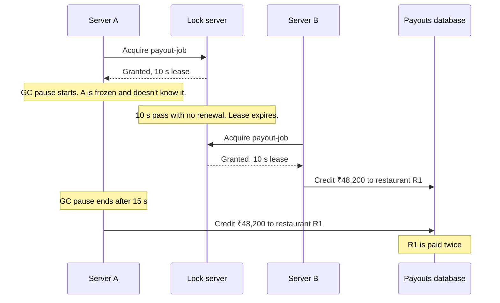
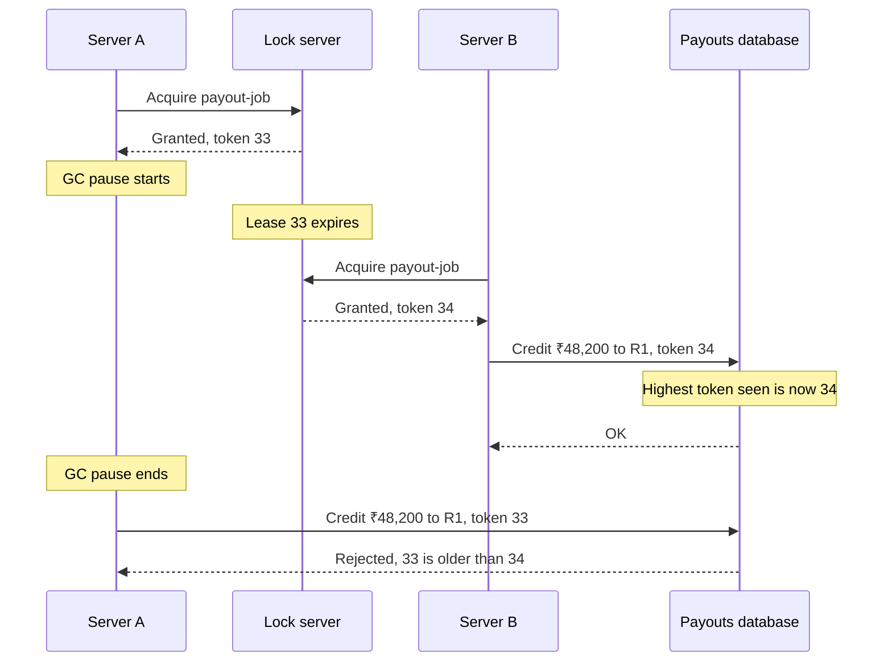

# How leases and fencing tokens evolved

> When you study system design today, concepts like leases and fencing tokens look like clean, elegant lines of code in a textbook. It is easy to take them for granted, assuming engineers designed them perfectly from day one.
>
> In reality, these patterns were forged through years of painful production outages, split-brain scenarios, and silent data corruption. Understanding why they evolved the way they did is one of the best ways to train your engineering intuition for distributed systems.

Every stage on this page answers one question: **how do we let exactly one machine own something, when that machine can crash, freeze or lose the network at any moment, and nobody can tell which of these happened?** Each answer fixed the failure of the one before it, and each one left a new gap.

You don't need to know any lock service to read this page. If you have read [How consensus evolved](../01-consensus/01-evolution.md), you will notice one idea from there coming back at the end: numbering each period of ownership, and refusing anything from an older one.

## The example we will use

A food delivery company runs a **nightly payout job**. It reads the day's orders and credits each restaurant partner, for example ₹48,200 to one restaurant and ₹12,750 to another. The job runs on one of three servers, so that it still runs if one server is down.

The job must run on **exactly one** server at a time. If two copies run together, restaurants get paid twice. If none runs, restaurants don't get paid. Every stage below is a different answer to "which server runs the job tonight, and how do the others know?"

## The story at a glance

| Era | What happened | The question it answered |
|-----|---------------|--------------------------|
| Before 1989 | Plain locks from a lock server, released by the holder | Who may do the work? |
| 1989 | **Leases** (Gray and Cheriton) | What if the holder crashes and never releases? |
| 1990s onward | The pause problem becomes visible: GC pauses, VM pauses, delayed packets | What if the holder is alive but frozen, and doesn't know its time is up? |
| 1990s–2000s | **STONITH** and I/O fencing in high-availability clusters | Can we make sure the old holder cannot touch the data? |
| 2006 | Chubby's **sequencers** | Can the data itself reject the old holder? |
| 2016 | The name **"fencing token"** spreads, through the Redlock debate | Is a lock without a token safe? |
| Throughout | **Epochs** inside consensus and replication protocols | The same idea, used everywhere |

---

## Stage 1: Plain locks with no expiry

### The question

How do we make sure only one server runs the payout job?

### The story

The most natural answer is the one we use inside a single program: a lock. A central **lock server** keeps a table of locks. A server asks for the lock `payout-job`, gets it, runs the job, and sends "release" when it finishes. Other servers asking for the lock are told to wait.

### The idea in plain words

The lock is granted until the holder gives it back. Ownership has a beginning (the grant) but its end is decided only by the holder.

### What it got right

While everything is healthy, it gives perfect mutual exclusion. **Mutual exclusion** means at most one holder at a time.

### What it left open

What if the holder crashes, loses its network connection, or gets stuck in an infinite loop before it releases the lock? The lock server keeps waiting for a "release" that will never come. The payout job never runs again, and the whole system stops.

The lock server cannot do anything smarter, because **from the outside, a slow server and a dead server look exactly the same**: both are simply silent. This is the same problem that sits at the heart of the consensus story.

### Where you find it today

Inside one machine, where the operating system can see a crashed process and clean up after it. For example, a file lock is released when the process that holds it exits. Across machines, a lock that never expires is almost never used on its own.

---

## Stage 2: Leases (1989)

### The question

If we can never know whether the holder is dead, can we at least put a limit on how long we wait?

### The story

In 1989, Cary Gray and David Cheriton at Stanford published *Leases: An Efficient Fault-Tolerant Mechanism for Distributed File Cache Consistency* at SOSP, the ACM Symposium on Operating Systems Principles. Their problem was not locks at all. It was caching in the V distributed operating system: a client may keep a copy of a file in its cache, and the server must not change the file while someone might be reading a stale copy.

Their answer was a **lease**: a grant that comes with a time limit. The paper describes it as a contract that gives its holder certain rights over a resource for a limited time. If the holder becomes unreachable, the server does not wait forever. It waits until the lease runs out, and then it is free to act.

### The idea in plain words

Apply this to our payout job. The lock server now says: *"You own `payout-job` for the next 10 seconds."* The holder must keep **renewing** the lease, for example every 3 seconds, while it works. If the holder crashes, renewals stop, the 10 seconds pass, and the lock server gives the lease to another server.

A lease turns "wait for a release that may never come" into "wait at most one lease term."

Two details from the paper matter a lot later:

- **Clocks don't need to show the same time.** The lease is sent as a *duration* ("10 seconds from now"), not as a time of day. What is needed is that clocks **run at nearly the same speed**, so that 10 seconds on the holder is close to 10 seconds on the server. This is called **bounded clock drift**. The paper treats a clock that runs badly wrong as a failure it does not handle.
- **The length of the term is a trade-off.** A short term means less waiting after a crash. A long term means fewer renewal messages. For the file access pattern they measured, Gray and Cheriton found that a term of about 10 seconds gave most of the benefit.

### What it got right

The system now recovers on its own from a crashed holder. A permanent deadlock became a short, predictable wait.

### What it left open

A lease is safe only if the holder **stops acting** the moment its lease ends. The lock server's side is easy: it simply waits out the term. But the holder has to notice that its time is up. The next stage shows why it often can't.

### Where you find it today

Almost every coordination system hands out leases:

- Google's GFS gives one replica of each chunk a lease to be the **primary**, the replica that decides the order of writes. The master does not give the lease to another replica until the old lease has expired.
- Google's Chubby lock service attaches every client session to a lease that the client keeps alive with regular messages.
- etcd has a lease API: a key can be attached to a lease, and it is deleted when the lease expires. etcd's lock is built on this.
- Kubernetes controllers elect a leader by updating a `Lease` object. The client-go documentation says its leader election tolerates any difference in clock *time* between machines, but not any difference in clock *speed*. That is the 1989 assumption, stated again.

---

## Stage 3: The pause problem

### The question

What if the holder is not dead, but frozen, and wakes up without knowing that its lease ended?

### The story

A lease assumes that the holder notices when its time is up. But a running program can stop at *any* instruction, for a long time, without knowing it stopped. Common reasons:

- **Garbage collection (GC) pauses.** In languages such as Java and Go, the runtime sometimes pauses all program threads to free memory. A "stop-the-world" pause can last seconds in bad cases.
- **Virtual machine pauses.** A cloud VM can be paused and moved to another physical host (live migration), or starved of CPU by other VMs on the same host.
- **Swapping.** When memory is short, the operating system moves memory pages to disk, and the program waits for the disk on every access.
- **Delayed network packets.** A request can sit in a network queue and arrive long after it was sent.

Here is the failure, in our payout job:



Both A and B behaved "correctly" from their own point of view. A really did hold the lease when it last checked. It simply could not see the 15 seconds it lost.

### Why "check the lease before writing" does not fix it

The obvious fix is for A to check, just before each write, whether its lease is still valid. It doesn't work, because the pause can happen **between the check and the write**:

```text
if lease.is_valid():       # true at this moment
    # <-- a 15-second pause can happen right here
    db.credit(r1, 48200)   # the lease is long gone
```

This is a **time-of-check to time-of-use** bug: the fact you checked was true when you checked it, but no longer true when you used it. No amount of checking inside the holder can close this gap, because the holder cannot tell that it was paused.

This is not only a theory. In *Designing Data-Intensive Applications*, Martin Kleppmann notes that HBase, a distributed database, used to have exactly this bug: long GC pauses let a lease expire while a server kept acting as the owner.

### What it got right

Seeing the problem clearly is the real progress of this stage. It shows that a lease protects the lock server's view of the world, but cannot by itself protect the **data**.

### What it left open

Something outside the paused holder has to stop it. There are two places to do that: at the holder (stop the machine itself) or at the data (refuse its writes). The next two stages take each road.

---

## Stage 4: STONITH, fencing with hardware

### The question

If the old holder may wake up at any time, can we make sure it is physically unable to touch the data?

### The story

High-availability (HA) clusters, which run a database or file server on two or more machines with shared disks, met this problem early. Their answer was blunt: before a new node takes over, it **switches the old node off**. This is called **STONITH**, short for "Shoot The Other Node In The Head." The word **fencing** comes from this world: you put a fence between the old node and the shared resource.

### The idea in plain words

Cluster software such as Pacemaker, used in Red Hat and SUSE HA clusters, supports two kinds of fencing:

- **Node-level fencing.** Power off or reset the old node. This is done through a network-controlled power switch, or through the server's management card (for example HP iLO or Dell DRAC).
- **Resource-level fencing.** Leave the node running, but cut its access to the shared disk. This is done through SCSI reservations, which let the storage itself accept commands only from the current owner, or by changing the storage network's zoning.

A related method, **SBD** (STONITH Block Device), asks the old node to fence itself: the new owner writes a "poison pill" message to a shared disk, and a node that reads it, or loses access to that disk, stops itself.

Only after the fencing step reports success does the new node start the service.

### What it got right

It is truly safe: a node that is switched off cannot write. And it does not depend on the old node noticing anything.

### What it left open

- **It needs special hardware**, and setting up a fencing device correctly is a project of its own.
- **Fencing can itself fail or be slow.** If the power switch does not answer, the cluster cannot safely continue, so it waits.
- **It does not fit shared-nothing systems.** In a modern system, the "resource" is often a database row, a Kafka topic or an object in cloud storage, used by thousands of clients. You cannot power off a client every time its lease expires.

### Where you find it today

Pacemaker and other traditional HA clusters, especially around shared storage. Cloud platforms use the same idea when they detach a disk volume from an old virtual machine before attaching it to a new one.

---

## Stage 5: Fencing with a number

### The question

Instead of stopping the old holder, can we make the **data** refuse its writes?

### The story

In 2006, Mike Burrows described Google's **Chubby** lock service at OSDI. Chubby runs on five replicas that use Paxos to agree on its state, and GFS and Bigtable used it to elect their masters. The paper names our exact problem: a process holds a lock, sends a request, and then fails. Another process gets the lock. Then the old request finally arrives, and is acted on without the lock's protection.

Chubby's answer was the **sequencer**. When a client acquires a lock, it can ask for a sequencer: a small string that contains the lock's name, the mode it was acquired in, and the lock's **generation number**, which goes up every time the lock changes hands. The client sends the sequencer along with its requests. The server that receives the request checks the sequencer and rejects it if it is no longer current, either by asking Chubby or by comparing it with the latest sequencer it has seen.

Chubby also offered a weaker fallback, for servers that could not check sequencers: **lock-delay**. When a lock holder fails or disappears, Chubby refuses to give the lock to anyone else for a short time, up to a limit of one minute, so that late requests from the old holder are likely to have arrived and finished first. "Likely" is the important word. Lock-delay reduces the risk; only the sequencer removes it.

Ten years later, in February 2016, Martin Kleppmann published a blog post, *How to do distributed locking*, which reviewed **Redlock**, a lock algorithm proposed for Redis. He gave the pattern the name that stuck: the **fencing token**. His main criticism was that Redlock produces no such token, so its safety depends on timing: network delays, process pauses and clock behaviour all have to stay within limits. Redis's author, Salvatore Sanfilippo, replied in *Is Redlock safe?*, and the two posts are still the clearest public debate on the topic. Kleppmann then used the same example in *Designing Data-Intensive Applications*.

### The idea in plain words

Three rules make up the pattern:

1. **Every grant gets a number that only goes up.** Each time the lock service grants the lease, it attaches a token one larger than the last: 33, then 34, then 35.
2. **Every write carries the token.** The holder sends its token with each request to the storage.
3. **The storage remembers the highest token it has seen, and rejects anything lower.** This check and the write must happen together, in one atomic step on the storage side.

Here is the payout story again, with tokens:



The work is now split cleanly:

- **The lease decides who *should* be acting.** It gives *liveness*: after a crash, someone else takes over within one lease term.
- **The fencing token decides whose writes *count*.** It gives *safety*: a stale holder cannot do damage, however long it was paused and however wrong its clock is.

Notice that the storage never needs to know what time it is. It only compares two numbers.

### What it got right

Safety no longer depends on timing. A pause, a slow network or a drifting clock can make the system wait longer, but cannot make it pay a restaurant twice. And unlike STONITH, it needs no hardware and works with any number of clients.

### What it left open

- **The resource has to take part.** The token is useless if the storage does not check it. A plain key-value store, a third-party payment API or an email service usually has no idea what your token means. For such resources you need some form of **conditional write**: "do this only if the current value or version is still X." Postgres can do this with a `WHERE` condition on a version column, and Amazon S3 added conditional writes in 2024 (`If-None-Match` in August, `If-Match` in November).
- **The token must come from a reliable source.** The numbers must truly only go up, even when the lock service itself loses a machine. In practice, that means the lock service is built on consensus. This was exactly Kleppmann's point about Redlock: its random lock values are not ordered, and a counter on one Redis node is lost if that node fails.
- **Work that already happened outside the storage cannot be undone.** If the stale holder sent an SMS before it touched the database, the token cannot take the SMS back. Fencing protects the resource that checks it, and nothing else.

### Where you find it today

- **Chubby**: sequencers, as described above.
- **ZooKeeper**: the `zxid` (the transaction ID that orders every change in ZooKeeper) or the version number of the lock's znode can be used as the token.
- **etcd**: every change to etcd increases a cluster-wide **revision** number that never goes back. The revision at which the lock key was created serves as the token.
- **Kubernetes client-go leader election** is a useful example of a system that chose *not* to provide this. Its documentation says plainly that it does not guarantee only one client acts as leader, and calls the missing part fencing. Controllers that need a stronger guarantee must add their own check at the resource.

---

## Stage 6: Epochs everywhere

### The question

Is the fencing token a trick for lock services only, or a more general idea?

### The story

Once you know the shape, you see it in almost every protocol from the consensus page. Each one numbers its periods of leadership and refuses messages from an older period:

| Where | Name of the number | What it fences out |
|-------|--------------------|--------------------|
| Paxos | Ballot number | Proposals from an older proposer |
| Viewstamped Replication, PBFT | View number | Messages from a replaced primary |
| Raft | Term | A deposed leader that still sends `AppendEntries` |
| ZooKeeper's Zab | Epoch | An old primary after a new one is established |
| Kafka | Controller epoch, leader epoch, producer epoch | A stale controller, an old partition leader, an older copy of a producer |
| Chubby | Lock generation number (in sequencers) | An old lock holder |

The terms differ, but the move is the same: **number each period of ownership, carry the number with every action, and let the receiver reject anything older than the newest number it has seen.**

### The idea in plain words

A fencing token is what this idea looks like when the "receiver" is a separate storage system rather than another member of the same cluster. Inside Raft, followers check the term themselves. Between your service and your database, the database has to check the token. Same rule, different place.

### Where you find it today

Everywhere ownership changes hands: elected leaders, partition owners in a sharded database, the one worker allowed to process a queue partition, the one primary allowed to write a file.

---

## Side by side

| | What it does | Failure it handles | What it still cannot handle | Needs |
|---|---|---|---|---|
| **Plain lock** | Grants ownership until the holder releases it | Two holders at once, while everyone is healthy | A crashed holder (permanent deadlock) | A lock server |
| **Lease** | Grants ownership for a limited time, renewed while alive | A crashed holder | A paused holder that wakes up and keeps acting | Clocks that run at nearly the same speed |
| **Lock-delay** (Chubby) | Waits a while longer before giving the lock to someone else | Most late requests from a failed holder | A request delayed longer than the wait | Nothing from the resource |
| **STONITH / I/O fencing** | Powers off the old holder or cuts its disk access | A paused holder, in a shared-storage cluster | Clusters without fencing hardware; many-client systems | Fencing devices |
| **Fencing token** | Attaches an increasing number; the resource rejects older numbers | A paused holder, a delayed request, a wrong clock | Resources that cannot check the number; side effects outside the resource | A consensus-backed token source and a resource that checks it |

---

## Three things to remember

1. **A lease gives progress, not safety.** It guarantees that someone takes over after a crash. It cannot guarantee that the old owner has stopped, because the old owner may not know it was paused.
2. **Safety has to be enforced where the data is.** The holder cannot reliably check itself. Either stop the holder from outside (STONITH), or make the resource reject it (a fencing token). The second works for far more systems.
3. **A fencing token is an epoch number.** Raft terms, Paxos ballots and Kafka epochs are the same idea. When you design any system where ownership moves, ask: "What number tells the receiver that this owner is out of date, and who checks it?"

---

## Read the originals

In a sensible order, from gentlest to deepest:

1. [How to do distributed locking](https://martin.kleppmann.com/2016/02/08/how-to-do-distributed-locking.html), Martin Kleppmann, 2016. The clearest short explanation of the pause problem and fencing tokens.
2. [Is Redlock safe?](https://www.antirez.com/news/101), Salvatore Sanfilippo, 2016. The reply. Read it to see which assumptions the two authors disagree on.
3. [The Chubby lock service for loosely-coupled distributed systems](https://storage.googleapis.com/gweb-research2023-media/pubtools/4444.pdf), Mike Burrows, OSDI 2006. See the section on locks and sequencers.
4. [Leases: An Efficient Fault-Tolerant Mechanism for Distributed File Cache Consistency](https://pages.cs.wisc.edu/~remzi/Classes/739/Fall2015/Papers/leases89.pdf), Cary Gray and David Cheriton, SOSP 1989. The original lease paper.
5. *Designing Data-Intensive Applications*, Martin Kleppmann, chapter 8, "The Trouble with Distributed Systems". Process pauses, unreliable clocks and fencing tokens, in one place.
6. [Fencing and STONITH](https://documentation.suse.com/sle-ha/html/SLE-HA-all/cha-ha-fencing.html), SUSE Linux Enterprise High Availability documentation. How hardware fencing is set up in practice.
7. [client-go leader election](https://pkg.go.dev/k8s.io/client-go/tools/leaderelection), Kubernetes. A short, honest statement of what a lease-based election does and does not promise.
